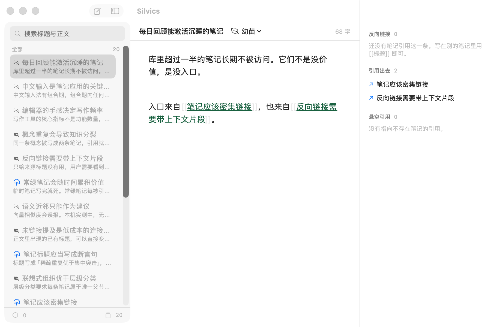
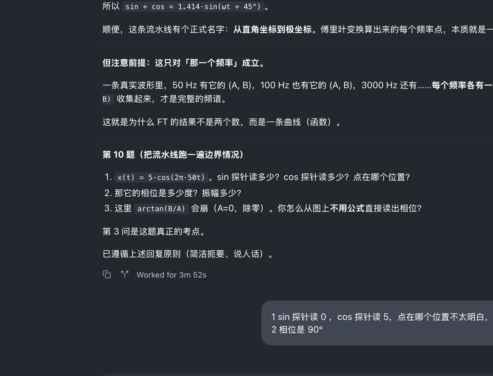

# Silvics

[](https://github.com/pipi32167/Silvics/releases/latest)


单人用的 macOS 原生笔记应用。笔记正文是 Markdown 纯文本，写概念名时自动找出已有笔记并提示建立连接。

名字取自 **silvics**（林业术语，研究林木如何生长），对应「笔记需要培育，不需要归档」。

下载：[最新版本](https://github.com/pipi32167/Silvics/releases/latest)（DMG，macOS 14+，Apple 芯片）。
ad-hoc 签名，首次打开需右键「打开」。安装细节见 [docs/RELEASE.md](docs/RELEASE.md)。



## 核心设计

**标题即接口。** 标题写成完整断言句（`稀疏重复优于集中突击`），才能在别的笔记正文里当作自然语言句子使用。机器能定位它，连接才能自动成立。这是自动连接的前提，也是新建笔记时强制校验标题的原因。

**连接分四层，硬软隔离。**

| 层 | 机制 | 可靠性 | 改正文 | 进主图 |
| --- | --- | --- | --- | --- |
| L1 | `[[ ]]` 显式引用 | 确定 | 是（用户手动） | 是 |
| L2 | 未链接提及（字符串匹配已有标题） | 确定 | 一键转 | 否 |
| L3 | 概念抽取 → 建议新建 | 中 | 永不 | 否 |
| L4 | embedding 语义近邻 | 低 | 永不 | 否 |

L3 与 L4 永不改写用户正文。自动改一次错，整个连接层的信任归零。

**剪藏是第三种笔记类型，单向引用。** 文档收进 `clips/`，与概念笔记、日记同库同步。概念笔记与日记都能用 `[[剪藏标题]]` 指向它；剪藏正文不解析 `[[ ]]`、不产出边、不跑提及、不进主列表与 `⌘P`。模型一次生成标题、摘要与 3–5 个标签。

**右栏 AI 提问，会话跟着笔记走。** 笔记、日记、剪藏都能就当前这篇提问。每个笔记一个会话，落 `ai/<id>.jsonl`，跟着 vault 同步：两台设备各问各的，合并后是并集，不互相覆盖。在编辑器里选中一段按 `⌘⇧Q` 可以只追问那一段；点「联网」可以抓一个网页作为本轮材料，抓回的正文只进当前一轮，不回灌历史。常用提示词在设置里改，内置 4 条可改不可删。

**正文是唯一真相。** 连接表、提及表、向量表都是索引，任何时候都能从正文全量重建。这消除「图里有边、正文里没有」的漂移。



**L2 已落地：未链接提及。** 正文里写到已有标题（或别名）时，该片段带点状下划线，右侧面板列出可一键转换。批量整理分三步：选择 → 看 diff → 转换，转换可撤销。

| 动作 | 快捷键 |
| --- | --- |
| 按标题打开笔记（Quick Open） | `⌘P` |
| 孤儿笔记 | `⌘⇧O` |
| 把光标所在提及转成引用 | `⌘⇧K` |
| 整理未链接提及 | `⌘⇧M` |
| 重命名笔记（连带改写正文引用） | `⌘⇧R` |
| 编辑别名 | `⌘⇧A` |
| 立即保存 | `⌘S` |
| 备份与同步… | `⌘⇧B` |
| 立即同步 | `⌘⇧Y` |
| 跳到今天的日记 | `⌘⇧J` |
| 待办总览（跨全部日记） | `⌘⇧T` |
| 新建剪藏 | `⌘⇧V` |
| 剪藏（未读） | `⌘⇧L` |
| 切到右栏 AI 提问 | `⌘⌥A` |
| 引用选中内容提问 | `⌘⇧Q` |

## 技术栈

| 层 | 选择 | 理由 |
| --- | --- | --- |
| 编辑区 | 原生 `NSTextView`（TextKit 2） | WKWebView 的中文输入有已知缺陷，且拿不到系统文本服务 |
| 存储 | GRDB 7（SQLite WAL） | SwiftData 无全文搜索 |
| 全文搜索 | FTS5 `trigram` 分词器 | 中文子串可搜 |
| Markdown 解析 | `swift-markdown` | 只用于非引用语法与导出 |
| 引用解析 | 自写 `WikiScanner` | 编辑器要字符区间，不要 AST |
| 工程 | xcodegen | `project.yml` 是唯一真相 |

## 备份与同步

真相层不是 sqlite，而是 vault 目录里的 Markdown 文件。sqlite 只是本机索引，随时能从 vault 重建。

```text
vault/
  notes/<id>.md     正文 + frontmatter（标题、状态、别名、已忽略的提及）
  journal/<日期>.md 日记，一天一篇
  clips/<id>.md     剪藏，frontmatter 多出 clip: 段与 tags:
  manifest.json     条数与每篇整篇哈希，校验用
```

同步用 git，不用云盘同步数据库：`.sqlite` 在 WAL 下跨设备必坏。git 只负责搬字节，合并由应用自己算 —— 绝不让 `git merge` 把 `<<<<<<<` 写进正文。

三条硬规则：导出只写不删（库空了不能把备份也清掉）；文件名用 id 不用标题（标题会改名）；vault 里有而库里没有的笔记，同步时自动收编（换机器靠这条恢复）。

细节见 [docs/备份与同步.md](docs/备份与同步.md)。

## 图标

图标是一根向上生长的枝、一片叶、三个渐小的琥珀点，最外面一个点与枝断开。绿是「已连接的引用」，琥珀是「未链接的提及」，断开的那个点就是还没建立的那条边。

两个色值直接取自 `Theme.swift`。图标不用设计软件画，由 `tools/icon/draw.swift` 生成：

```bash
swiftc -O -o /tmp/icongen tools/icon/draw.swift
/tmp/icongen Sources/Silvics/Resources/Assets.xcassets /tmp/icon-preview
```

小尺寸（≤ 32px）走另一套参数：主干、叶、断点都加粗，否则 16px 只剩一条 1px 的淡线。

## 构建

需要 Xcode 26+、macOS 14+、`xcodegen`。

```bash
# 本机 Xcode 不在默认位置时必须设
export DEVELOPER_DIR=/Applications/Xcode.app/Contents/Developer

xcodegen generate
xcodebuild -project Silvics.xcodeproj -scheme Silvics -configuration Debug \
  -destination 'platform=macOS' -derivedDataPath .build \
  CODE_SIGNING_ALLOWED=NO build
```

产物在 `.build/Build/Products/Debug/Silvics.app`。

SPM 拉依赖时如果卡在 `Fetching from https://github.com/...`，说明到 GitHub 的 HTTPS 不通，挂代理再跑：

```bash
export HTTPS_PROXY=http://127.0.0.1:7890 HTTP_PROXY=http://127.0.0.1:7890 ALL_PROXY=http://127.0.0.1:7890
export GIT_CONFIG_COUNT=1 GIT_CONFIG_KEY_0=http.proxy GIT_CONFIG_VALUE_0=http://127.0.0.1:7890
```

跑测试：

```bash
xcodebuild -project Silvics.xcodeproj -scheme Silvics -configuration Debug \
  -destination 'platform=macOS' -derivedDataPath .build \
  CODE_SIGNING_ALLOWED=NO test > /tmp/silvics-test.log 2>&1
grep -E "TEST (SUCCEEDED|FAILED)" /tmp/silvics-test.log
```

## 文档

- [docs/RELEASE.md](docs/RELEASE.md)：版本策略与发布脚本
- [docs/设计文档.md](docs/设计文档.md)：完整设计，含本机实测数据（UTF-8 字节偏移坑、Aho–Corasick 对比、`NLEmbedding` 中文不可用）
- [docs/HANDOFF.md](docs/HANDOFF.md)：进度、已知缺陷、下一步

## 日记编辑器原型

日记编辑器的低保真原型是纯静态页面，零依赖、零构建。代码在 `prototype/journal/`。

起本地服务：

```bash
cd prototype/journal
python3 -m http.server 8791
# 打开 http://127.0.0.1:8791/index.html
```

页内用例 77 条。点左栏「边界用例」按钮，或在页面控制台执行：

```js
window.runEdgeCases() // { pass: 77, fail: 0 }
```

另有 9 条输入法与撤销用例只能在真机人工确认。

端到端审计 28 条，覆盖真键入、回车、退格、粘贴、方向键、300 行耗时。服务必须先起：

```bash
ego-browser nodejs < prototype/journal/audit-codeblock.mjs
# 末行应为 28/28 通过
```

用例库与移植说明见 [docs/日记编辑器边界用例.md](docs/日记编辑器边界用例.md)。

## 进度

P1 完成：写作、`[[` 补全、引用与悬空样式、反向链接面板、自动保存、全文搜索。

P2 完成：Aho–Corasick 提及扫描（Release 实测 0.035 ms / 1000 标题）、未链接提及面板、批量转换与 diff 预览、撤销、别名、改名时批量重写正文引用。

P3 完成：`⌘P` Quick Open（前缀 / 包含 / 二元组相似度排序）、孤儿笔记视图、`#标签` 扫描与侧栏筛选、搜索摘要居中（1000 条实测 4.7 ms）。

备份与同步（0.1.1）：真相层迁到 vault 目录，sqlite 降为索引；导出 / 恢复 / 校验；git 双向同步与 diff3 三方合并（同一行冲突保留本地并留档）。

编辑器排版（0.2.2）：无序/有序列表带项目符号与悬挂缩进（软换行第二行与首行文字对齐）、待办行是可点复选框（点击改正文 `[ ]` ↔ `[x]`）、引用左侧竖线、表格按显示宽度对齐（CJK 计 2 列、ASCII 计 1 列）。全部只改属性，正文仍是 Markdown 原文。

日记（0.2.0）：独立类型 `journal`，一天一篇，文件落 `journal/<日期>.md`，id 由日期派生（两端不会各建一篇）。模块用 `##` 标题，模板 `templates/<名>.md` 只注入骨架。未完成待办自动承接到下一天（插在光标所在行之前，同名不重复）。编辑器是混合模式：**光标所在段落露源码，其他段落只显示渲染结果**；代码块按语言上色（swift/js/python/json/bash/latex）。待办总览跨日记聚合，同一句取最近一天状态。

P4 进行中：设置页已完成（外观、模型服务、同步、关于）；支持本地 magpie / Ollama 免密钥；同步按「启动一次 + 定时 + 失焦节流 + 手动」运行；冲突用 LLM 合并但需人工确认。L3 概念线索与 L4 相关笔记本体未做。
