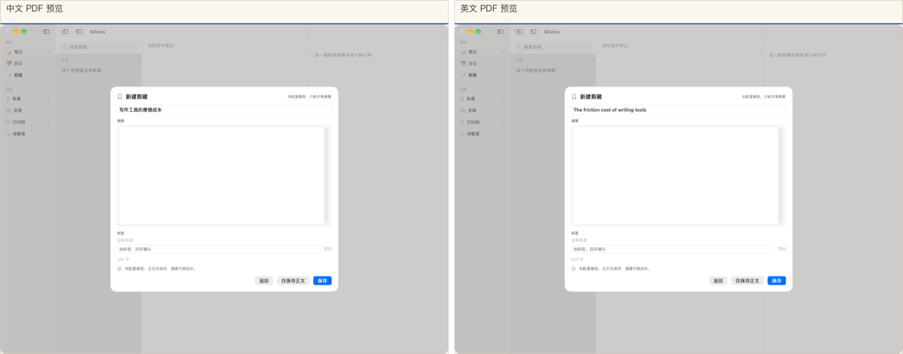
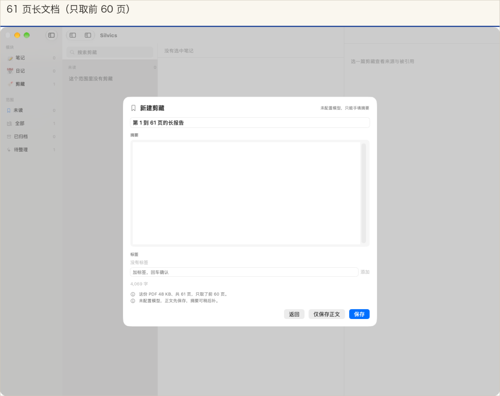
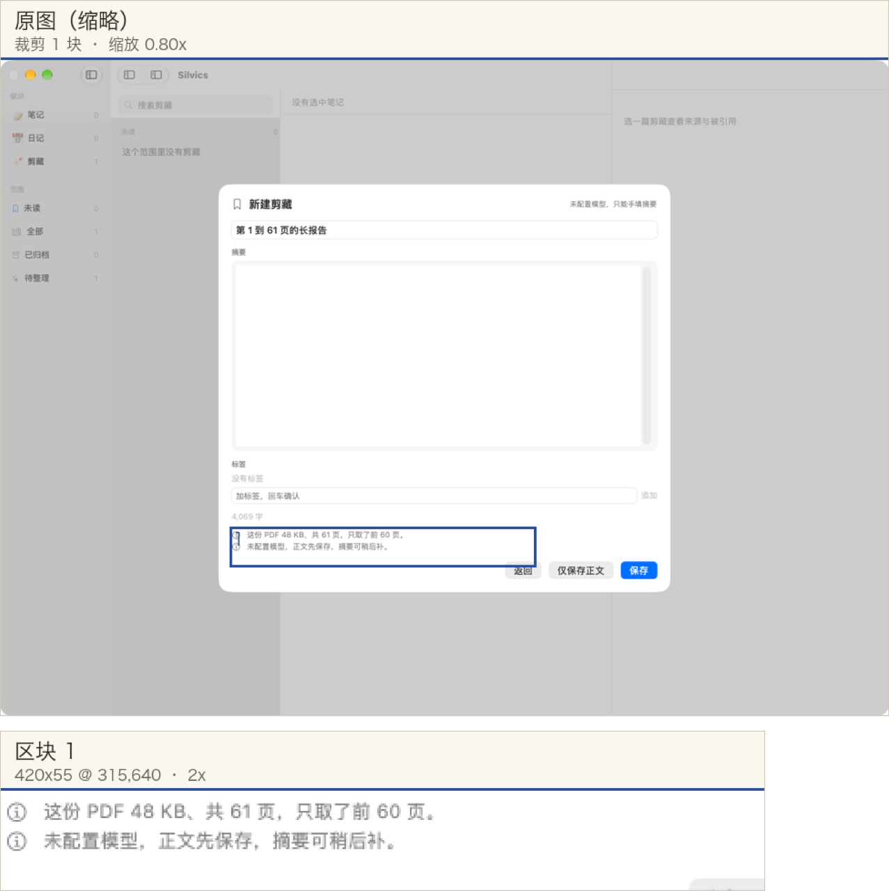
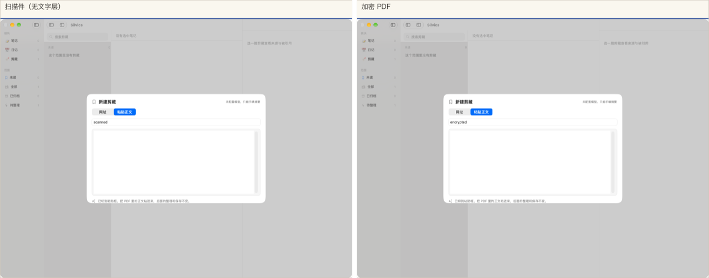
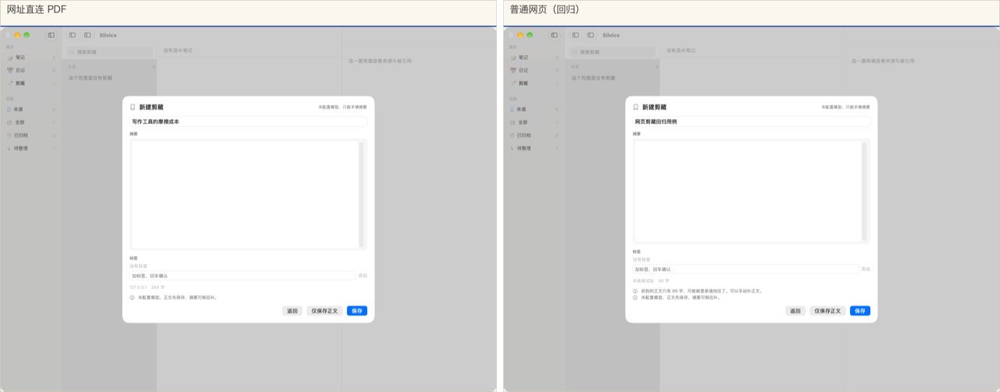
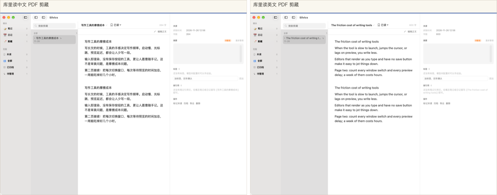
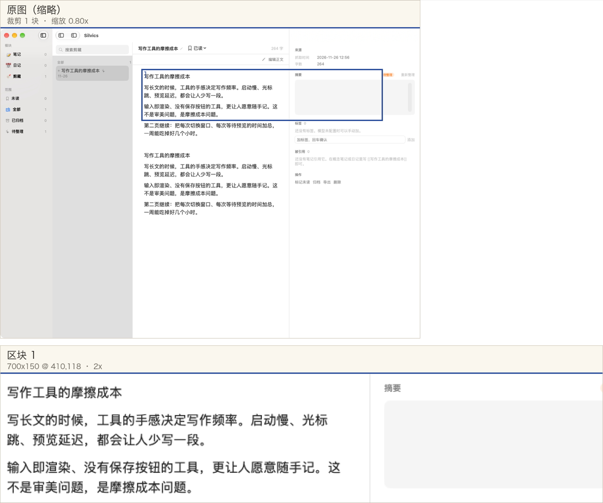
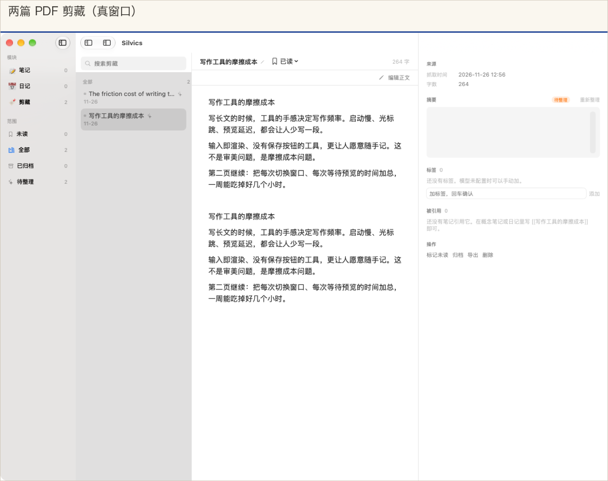

# silvics · feat-clip-pdf-verify 验收报告

## 元信息

| 项 | 值 |
| --- | --- |
| commit | 962f1ad |
| 验收时间 | 2026-11-26 12:59 CST |
| 环境 | macOS 14+，Debug 构建，真窗口截屏（屏幕未锁，窗口 1220x900） |
| 数据 | 自造 PDF 夹具：中英两页件、61 页长文档、无文字层扫描件、带密码加密件；本地 HTTP server 8799 提供 PDF 与网页 |
| 缓存版本 | 待确认 |
| 验收人 | agent |

## 结论

通过 8 项，不通过 0 项，待确认 0 项，未覆盖 3 项。

## 覆盖用例

| # | 用例 | 判据 | 结果 | 证据 |
| --- | --- | --- | --- | --- |
| 01 | 电子版 PDF 导入后的预览 | 标题取文档属性；字数=抽取结果；无乱码 | 通过 | `artifacts/01-pdf-preview-zh-en.png` |
| 02 | 超过 60 页按页截断 | 提示写明体积、总页数、实际取了几页 | 通过 | `artifacts/02-pdf-truncated.png` |
| 03 | 截断提示 2x 细节 | 「这份 PDF 48 KB、共 61 页，只取了前 60 页。」文案完整、单位正确 | 通过 | `artifacts/03-truncate-warning-4x.png` |
| 04 | 扫描件与加密件的兜底 | 给明确原因；自动切到粘贴框；标题预填文件名；不写空剪藏 | 通过 | `artifacts/04-pdf-reject-fallback.png` |
| 05 | 网址入口：PDF 与网页走同一条抓取链 | 同一面板两种结果都对；网页剪藏未变 | 通过 | `artifacts/05-url-pdf-and-web.png` |
| 06 | 存进库后的阅读效果 | 标点正确；段落完整；页与页之间空行 | 通过 | `artifacts/06-reader-zh-en.png` |
| 07 | 正文 2x 细节 | 「，」「。」是全角；「工具」「长文」已从康熙部首折回；段内折行已接回 | 通过 | `artifacts/07-zh-body-4x.png` |
| 08 | 剪藏列表与计数 | 列表两行；未读 0、全部 2、待整理 2 | 通过 | `artifacts/08-clip-list.png` |

## 偏差清单

| 区域 | 设计稿值 | 实现值 | 判定 | 证据 |
| --- | --- | --- | --- | --- |
| 面板拖拽落点 | 提示写「把文件或网址拖到这里」，按钮区与空白区都算「这里」 | 原来只有输入区能接拖拽，面板下半部分没反应 | 已修复 | `artifacts/01-pdf-preview-zh-en.png` |
| 页数上限与体积上限 | issue #30：沿用 5 MB 上限，超过时只取前 N 页 | 页数 60 页即截断（与体积无关）；本地 100 MB、网址 20 MB 才是硬拒 | 已修复 | `artifacts/02-pdf-truncated.png` |

## 未覆盖

| 用例 | 原因 |
| --- | --- |
| 拖拽导入的手势 | 用 CGEvent 合成的拖拽在这台机器上起不了 Finder 拖拽会话：面板里的 handleDrop 打印一次都没触发，说明事件没进 App，不是落点写错。落点已扩到整个面板并加了高亮，落下来的处理和「选择文件」同一条 ingestFile |
| 深色模式 | 本次改动只有提示文案与拖入描边，没有新的外观分支；深色下沿用同一套 Label 与 accentColor |
| 100 MB 上限的实际夹具 | 有单测覆盖阈值判断，没造 100 MB 的文件；URL 侧 20 MB 拒绝有单测 |

## 复现命令

```bash
swiftc -O docs/acceptance/clip-pdf-v0.6.1/make-fixtures.swift -o /tmp/mkpdf && /tmp/mkpdf   # 造 PDF 夹具到 /tmp/pdf-fix
cd /tmp/pdf-fix && python3 -m http.server 8799 --bind 127.0.0.1   # 网址用例
SILVICS_SHOW=new-clip SILVICS_CLIP_FILE=/tmp/pdf-fix/zh.pdf SILVICS_VAULT=/tmp/v SILVICS_DB=/tmp/d.sqlite .build/Build/Products/Debug/Silvics.app/Contents/MacOS/Silvics   # 面板预览态（真实导入）
SILVICS_SHOW=clip-pdf SILVICS_CLIP_FILE=/tmp/pdf-fix/zh.pdf SILVICS_VAULT=/tmp/v SILVICS_DB=/tmp/d.sqlite .build/Build/Products/Debug/Silvics.app/Contents/MacOS/Silvics   # 导入并读
screencapture -x -o -l$(窗口ID) out.png   # 窗口 ID 按 pid + kCGWindowOwnerPID 取；抓 sheet 会连父窗口一起截
```

## 证据图

### 01 电子版 PDF 导入后的预览



[原图](artifacts/01-pdf-preview-zh-en.png) · 通过 · 判据 标题取文档属性；字数=抽取结果；无乱码

真窗口截图，面板叠在主窗口上

### 02 超过 60 页按页截断



[原图](artifacts/02-pdf-truncated.png) · 通过 · 判据 提示写明体积、总页数、实际取了几页

状态矩阵 61 页长文档（只取前 60 页）

### 03 截断提示 2x 细节



[原图](artifacts/03-truncate-warning-4x.png) · 通过 · 判据 「这份 PDF 48 KB、共 61 页，只取了前 60 页。」文案完整、单位正确

细节放大 1 块 x2

### 04 扫描件与加密件的兜底



[原图](artifacts/04-pdf-reject-fallback.png) · 通过 · 判据 给明确原因；自动切到粘贴框；标题预填文件名；不写空剪藏

状态矩阵 扫描件（无文字层） / 加密 PDF

### 05 网址入口：PDF 与网页走同一条抓取链



[原图](artifacts/05-url-pdf-and-web.png) · 通过 · 判据 同一面板两种结果都对；网页剪藏未变

本地 HTTP server 8799 提供 zh.pdf 与 post.html

### 06 存进库后的阅读效果



[原图](artifacts/06-reader-zh-en.png) · 通过 · 判据 标点正确；段落完整；页与页之间空行

状态矩阵 库里读中文 PDF 剪藏 / 库里读英文 PDF 剪藏

### 07 正文 2x 细节



[原图](artifacts/07-zh-body-4x.png) · 通过 · 判据 「，」「。」是全角；「工具」「长文」已从康熙部首折回；段内折行已接回

细节放大 1 块 x2

### 08 剪藏列表与计数



[原图](artifacts/08-clip-list.png) · 通过 · 判据 列表两行；未读 0、全部 2、待整理 2

状态矩阵 两篇 PDF 剪藏（真窗口）

## 截图清单

| 文件 | 说明 | 差异 |
| --- | --- | --- |
| `artifacts/01-pdf-preview-zh-en.png` | 真窗口截图，面板叠在主窗口上 | — |
| `artifacts/02-pdf-truncated.png` | 状态矩阵 61 页长文档（只取前 60 页） | — |
| `artifacts/03-truncate-warning-4x.png` | 细节放大 1 块 x2 | — |
| `artifacts/04-pdf-reject-fallback.png` | 状态矩阵 扫描件（无文字层） / 加密 PDF | — |
| `artifacts/05-url-pdf-and-web.png` | 本地 HTTP server 8799 提供 zh.pdf 与 post.html | — |
| `artifacts/06-reader-zh-en.png` | 状态矩阵 库里读中文 PDF 剪藏 / 库里读英文 PDF 剪藏 | — |
| `artifacts/07-zh-body-4x.png` | 细节放大 1 块 x2 | — |
| `artifacts/08-clip-list.png` | 状态矩阵 两篇 PDF 剪藏（真窗口） | — |
