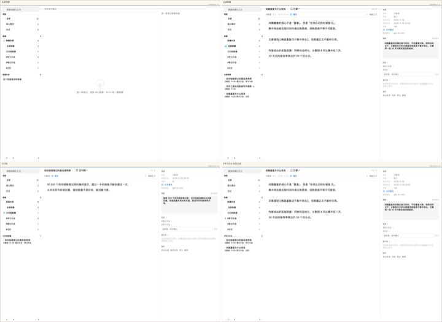
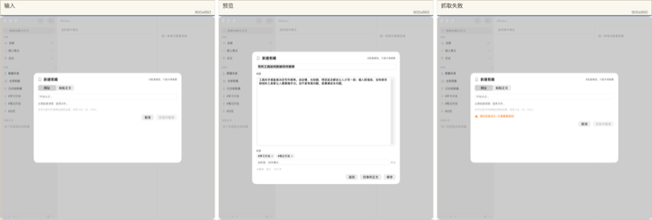
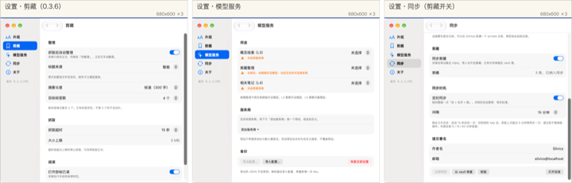
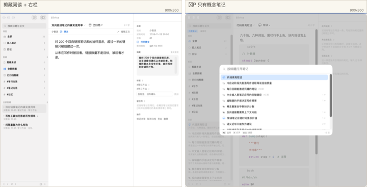
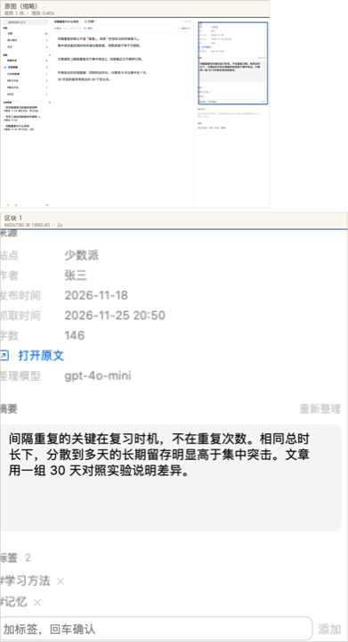
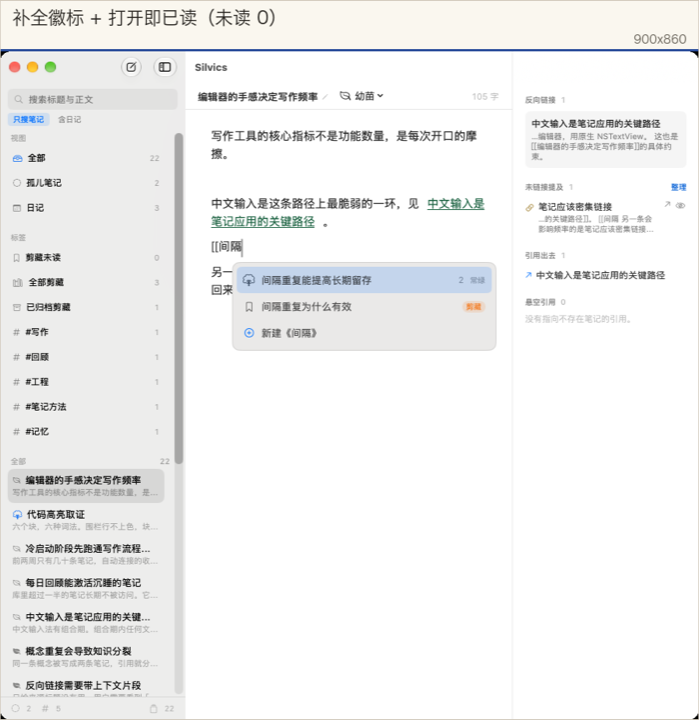

# silvics · feat/clips 验收报告

## 元信息

| 项 | 值 |
| --- | --- |
| commit | c6106d4 |
| 验收时间 | 2026-11-25 20:54 CST |
| 环境 | macOS 27 / Xcode 27.2 / Debug 0.3.6 |
| 数据 | 22 条概念笔记 + 3 篇剪藏 + 3 天日记 |
| 缓存版本 | Debug .build / xcodegen 2.48 |
| 验收人 | pi agent |

## 结论

通过 6 项，不通过 0 项，待确认 0 项，未覆盖 5 项。

## 覆盖用例

| # | 用例 | 判据 | 结果 | 证据 |
| --- | --- | --- | --- | --- |
| 01 | 01 剪藏四个范围 | 范围切换后列表与计数一致；标签过滤只出现剪藏 | 通过 | `01-clip-scopes.png` |
| 02 | 02 新建剪藏三态 | 输入→预览→失败三态可读；失败给具体原因；预览可改标题/摘要/标签 | 通过 | `02-new-clip-states.png` |
| 03 | 03 设置四处 | 剪藏页六项；模型服务有「剪藏整理」；同步页有「同步剪藏」开关与条数 | 通过 | `03-settings.png` |
| 04 | 04 隔离与阅读 | 剪藏不进 ⌘P；右栏显示来源/摘要/标签/被引用；正文只读 | 通过 | `04-isolation.png` |
| 05 | 05 右栏细节 2x | 来源/摘要/标签/被引用分组清楚，字号与间距一致 | 通过 | `05-right-panel-2x.png` |
| 06 | 06 补全徽标与打开即已读 | 剪藏项带书签与「剪藏」徽标；打开后未读归零 | 通过 | `06-completion-badge.png` |

## 偏差清单

无。

## 未覆盖

| 用例 | 原因 |
| --- | --- |
| 真实站点抓取 | 未对真实站点发起抓取；抓取、解码与抽取由固定 HTML 样本单测覆盖 |
| 真实模型整理 | 未配置服务商密钥；提示词、JSON 解析与降级由桩覆盖 |
| PDF 导入 | 范围外，见 issue #30 |
| 双端同步 | 未跑真实两台设备；本地 bare 远端的删除传播与合并用例已覆盖 |
| 中文输入法实测 | 沿用旧记录，需要人工敲拼音 |

## 复现命令

无。

## 证据图

### 01 01 剪藏四个范围

[原图](01-clip-scopes.png) · 通过 · 判据 范围切换后列表与计数一致；标签过滤只出现剪藏

侧栏剪藏区：未读/全部/已归档与剪藏标签

### 02 02 新建剪藏三态

[原图](02-new-clip-states.png) · 通过 · 判据 输入→预览→失败三态可读；失败给具体原因；预览可改标题/摘要/标签

失败态：403 提示「网页拒绝访问（可能需要登录）」

### 03 03 设置四处

[原图](03-settings.png) · 通过 · 判据 剪藏页六项；模型服务有「剪藏整理」；同步页有「同步剪藏」开关与条数

三张均为 680x600 设置窗口，版本 0.3.6

### 04 04 隔离与阅读

[原图](04-isolation.png) · 通过 · 判据 剪藏不进 ⌘P；右栏显示来源/摘要/标签/被引用；正文只读

⌘P 列表 12 项均为概念笔记，无剪藏

### 05 05 右栏细节 2x

[原图](05-right-panel-2x.png) · 通过 · 判据 来源/摘要/标签/被引用分组清楚，字号与间距一致

细节放大 1 块 x2

### 06 06 补全徽标与打开即已读

[原图](06-completion-badge.png) · 通过 · 判据 剪藏项带书签与「剪藏」徽标；打开后未读归零

0.3.6 构建；侧栏剪藏未读为 0

## 截图清单

| 文件 | 说明 | 差异 |
| --- | --- | --- |
| `01-clip-scopes.png` | 侧栏剪藏区：未读/全部/已归档与剪藏标签 | — |
| `02-new-clip-states.png` | 失败态：403 提示「网页拒绝访问（可能需要登录）」 | — |
| `03-settings.png` | 三张均为 680x600 设置窗口，版本 0.3.6 | — |
| `04-isolation.png` | ⌘P 列表 12 项均为概念笔记，无剪藏 | — |
| `05-right-panel-2x.png` | 细节放大 1 块 x2 | — |
| `06-completion-badge.png` | 0.3.6 构建；侧栏剪藏未读为 0 | — |
