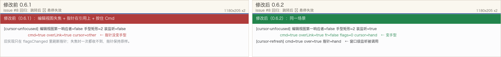
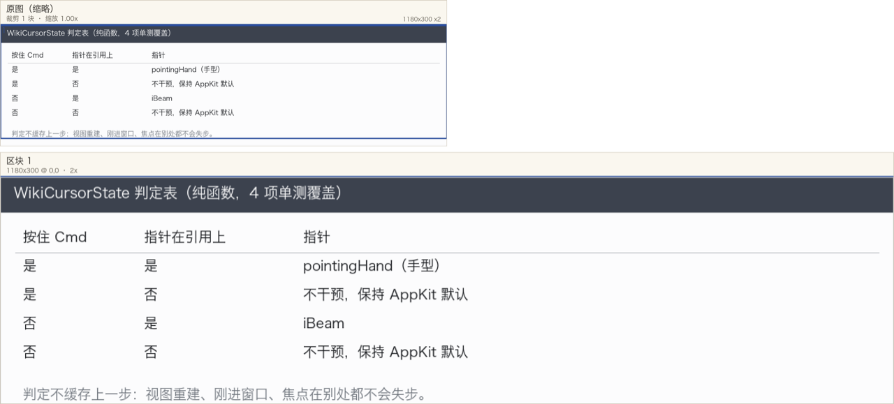

# silvics · issue8-cursor-monitor 验收报告

## 元信息

| 项 | 值 |
| --- | --- |
| commit | ea9f0d6 |
| 验收时间 | 2026-11-26 12:42 CST |
| 环境 | macOS 26.1 arm64 / Debug / 屏幕锁定下的自查钩子 |
| 数据 | vault=/tmp/vault-nav, 笔记=稀疏重复优于集中突击 |
| 缓存版本 | 待确认 |
| 验收人 | pipi32167 |

## 结论

通过 2 项，不通过 0 项，待确认 0 项，未覆盖 2 项。

## 覆盖用例

| # | 用例 | 判据 | 结果 | 证据 |
| --- | --- | --- | --- | --- |
| 01 | 编辑视图失焦时按 Cmd 的指针 | 同一场景下：修改后 cursor=hand，修改前 cursor=other | 通过 | `artifacts/01-unfocused.png` |
| 02 | 判定表（不缓存上一步） | 只有「按住 Cmd + 落在引用上」出手型；判定每次按当前输入重算 | 通过 | `artifacts/02-table.png` |

## 偏差清单

无。

## 未覆盖

| 用例 | 原因 |
| --- | --- |
| 真实按键的指针形状截图 | 指针在 screencapture 里不绘制；本次验收时屏幕处于锁定状态（CGSSessionScreenIsLocked=1），改为运行时探针取 NSCursor.current 真值 |
| 解锁后的人工复验 | 屏幕锁定无法点按；解锁后按 issue #8 步骤复验一次即可关闭 |

## 复现命令

```bash
xcodebuild -project Silvics.xcodeproj -scheme Silvics -configuration Debug -destination "platform=macOS" -derivedDataPath .build CODE_SIGNING_ALLOWED=NO test -only-testing:SilvicsTests/EditorUXTests
SILVICS_SHOW=module-notes SILVICS_VAULT=/tmp/vault-nav SILVICS_SELFTEST=cursor-unfocused SILVICS_CURSOR_TRACE=1 .build/Build/Products/Debug/Silvics.app/Contents/MacOS/Silvics；读 /tmp/silvics-debug.log 的 [cursor-unfocused] 与 [cursor-refresh] 行
```

## 证据图

### 01 编辑视图失焦时按 Cmd 的指针



[原图](artifacts/01-unfocused.png) · 通过 · 判据 同一场景下：修改后 cursor=hand，修改前 cursor=other

指针形状 screencapture 画不出来，证据是运行时 NSCursor.current 实测值；场景等价于 ⌘ 点击链接跳转后新视图还没拿到焦点

### 02 判定表（不缓存上一步）



[原图](artifacts/02-table.png) · 通过 · 判据 只有「按住 Cmd + 落在引用上」出手型；判定每次按当前输入重算

细节放大 1 块 x2

## 截图清单

| 文件 | 说明 | 差异 |
| --- | --- | --- |
| `artifacts/01-unfocused.png` | 指针形状 screencapture 画不出来，证据是运行时 NSCursor.current 实测值；场景等价于 ⌘ 点击链接跳转后新视图还没拿到焦点 | — |
| `artifacts/02-table.png` | 细节放大 1 块 x2 | — |
