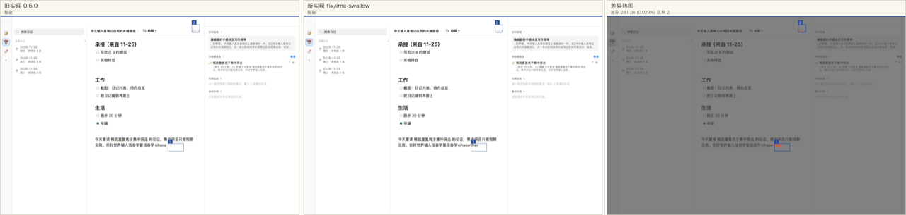
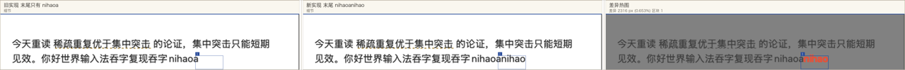
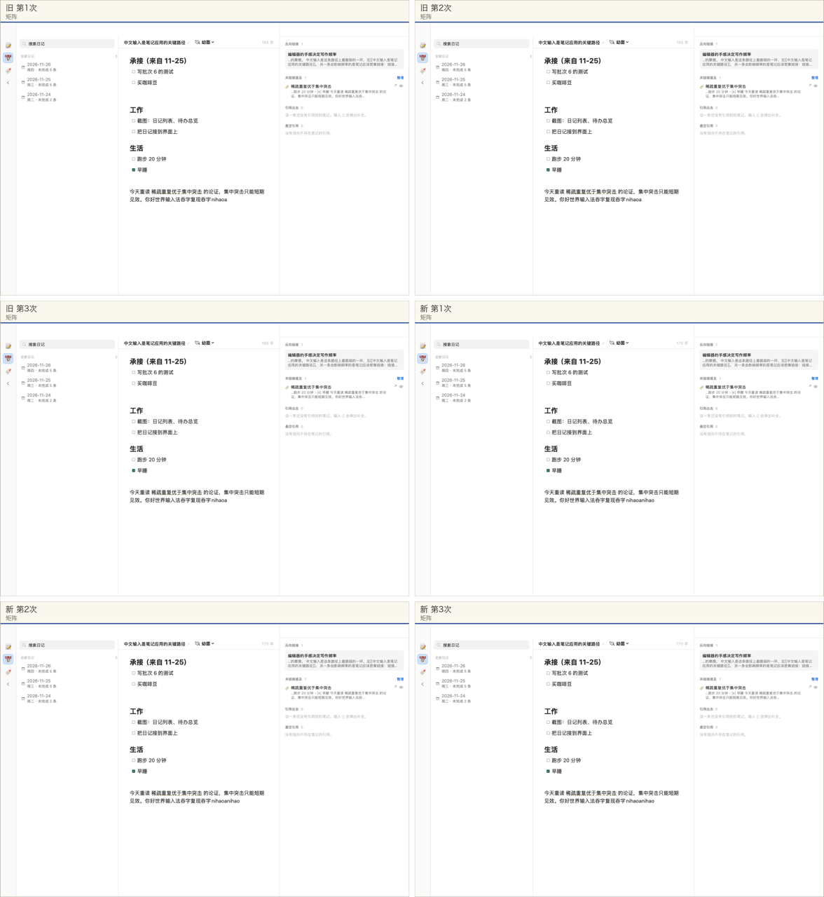

# silvics-ime · fix-ime-swallow 验收报告

## 元信息

| 项 | 值 |
| --- | --- |
| commit | a39da30 |
| 验收时间 | 2026-11-26 12:22 CST |
| 环境 | macOS 27 / Xcode 27.2 / Swift 6.4 / Debug / App Sandbox 关 |
| 数据 | SILVICS_SEED=1 演示库 22 篇；每次独立 vault 与库，起点正文 146 字 |
| 缓存版本 | 待确认 |
| 验收人 | pi |

## 结论

通过 3 项，不通过 0 项，待确认 0 项，未覆盖 2 项。

## 覆盖用例

| # | 用例 | 判据 | 结果 | 证据 |
| --- | --- | --- | --- | --- |
| 01 | 01 组合期外部改写：整窗 | 同一段输入法脚本跑完，末尾应保留组合期上屏的 nihao：旧实现 165 字（少 5），新实现 170 字 | 通过 | `artifacts/01-旧实现-0.6.0-新实现-fix-ime-swallow.png` |
| 02 | 02 细节 3x：末尾两段输入 | 末尾两行应同时保留上一轮上屏的 nihaoa 与组合期上屏的 nihao；旧实现只剩第一段 | 通过 | `artifacts/02-旧实现-末尾只有-nihaoa-新实现-末尾-nihaoanihao.png` |
| 03 | 03 状态矩阵：3 次重跑 | 旧实现 3/3 判据第 8 步失败（165/170 字），新实现 3/3 全部判据通过（170 字） | 通过 | `artifacts/03-matrix.png` |

## 偏差清单

无。

## 未覆盖

| 用例 | 原因 |
| --- | --- |
| 系统拼音输入法真机敲字 | 本机 TISSelectInputSource 返回 -50（paramErr），进程内外都切不到简体拼音输入源，无法驱动真实系统 IME。脚本按 NSTextInputClient 协议（setMarkedText → insertText）等价驱动编辑区，仍需人工在系统拼音下敲一次确认 |
| 真实同步冲突中的外部改写 | 要两台设备同时改同一篇。本次只覆盖 loadNote 一条外部改写路径（改名、批量转换、日记承接都走它） |

## 复现命令

```bash
SILVICS_DB=/tmp/ab/db.sqlite SILVICS_VAULT=/tmp/ab/vault SILVICS_SEED=1 SILVICS_SELFTEST=ime SILVICS_CAPTURE=/tmp/ab/out.png SILVICS_QUIT_AFTER_SELFTEST=1 .build/Build/Products/Debug/Silvics.app/Contents/MacOS/Silvics
DEVELOPER_DIR=/Applications/Xcode.app/Contents/Developer xcodebuild -project Silvics.xcodeproj -scheme Silvics -configuration Debug -destination "platform=macOS" -derivedDataPath .build CODE_SIGNING_ALLOWED=NO -only-testing:SilvicsTests/EditorIMETests test
```

## 证据图

### 01 01 组合期外部改写：整窗



[原图](artifacts/01-旧实现-0.6.0-新实现-fix-ime-swallow.png) · 通过 · 差异 281 px (0.029%) 区块 2 · 判据 同一段输入法脚本跑完，末尾应保留组合期上屏的 nihao：旧实现 165 字（少 5），新实现 170 字

旧实现 0.6.0 / 新实现 fix/ime-swallow

### 02 02 细节 3x：末尾两段输入



[原图](artifacts/02-旧实现-末尾只有-nihaoa-新实现-末尾-nihaoanihao.png) · 通过 · 差异 2316 px (0.653%) 区块 1 · 判据 末尾两行应同时保留上一轮上屏的 nihaoa 与组合期上屏的 nihao；旧实现只剩第一段

旧实现 末尾只有 nihaoa / 新实现 末尾 nihaoanihao

### 03 03 状态矩阵：3 次重跑



[原图](artifacts/03-matrix.png) · 通过 · 判据 旧实现 3/3 判据第 8 步失败（165/170 字），新实现 3/3 全部判据通过（170 字）

状态矩阵 旧 第1次 / 旧 第2次 / 旧 第3次 / 新 第1次 / 新 第2次 / 新 第3次

## 截图清单

| 文件 | 说明 | 差异 |
| --- | --- | --- |
| `artifacts/01-旧实现-0.6.0-新实现-fix-ime-swallow.png` | 旧实现 0.6.0 / 新实现 fix/ime-swallow | 差异 281 px (0.029%) 区块 2 |
| `artifacts/02-旧实现-末尾只有-nihaoa-新实现-末尾-nihaoanihao.png` | 旧实现 末尾只有 nihaoa / 新实现 末尾 nihaoanihao | 差异 2316 px (0.653%) 区块 1 |
| `artifacts/03-matrix.png` | 状态矩阵 旧 第1次 / 旧 第2次 / 旧 第3次 / 新 第1次 / 新 第2次 / 新 第3次 | — |
