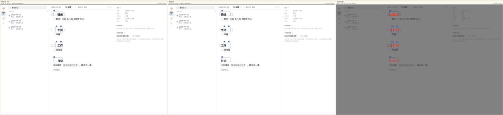
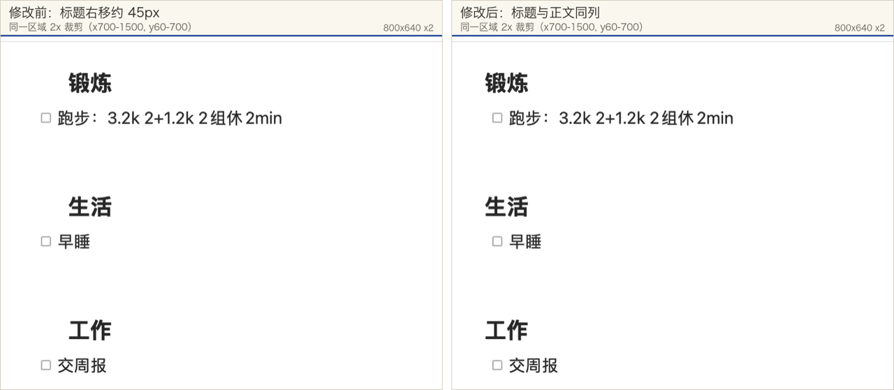
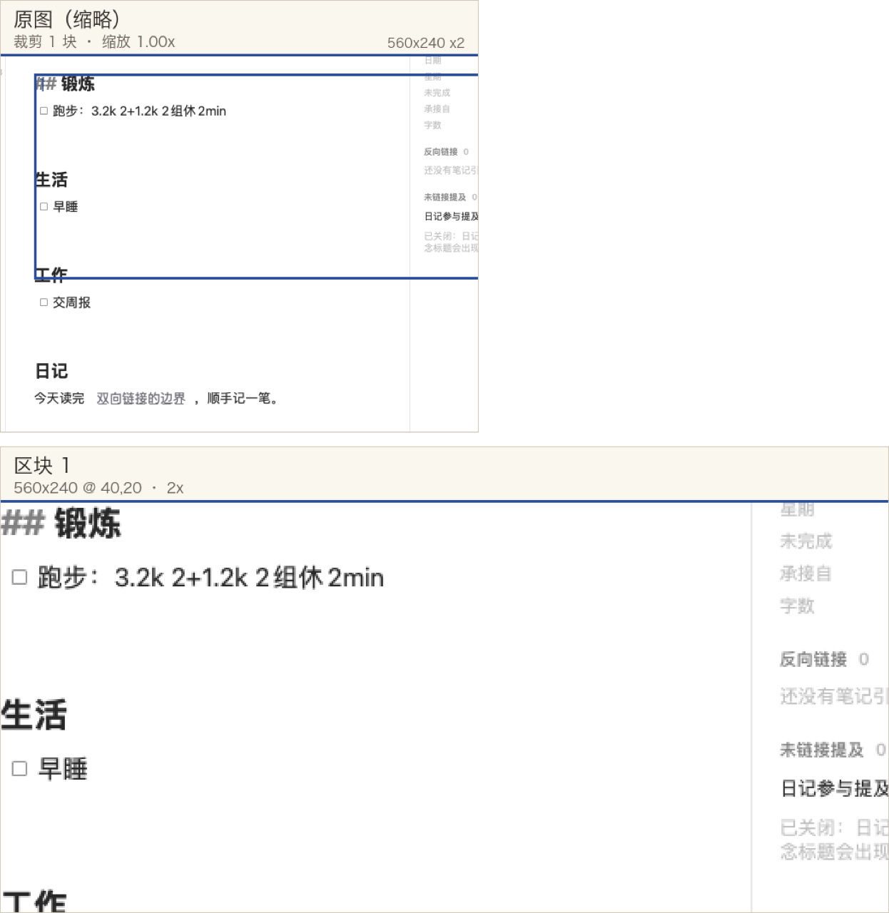
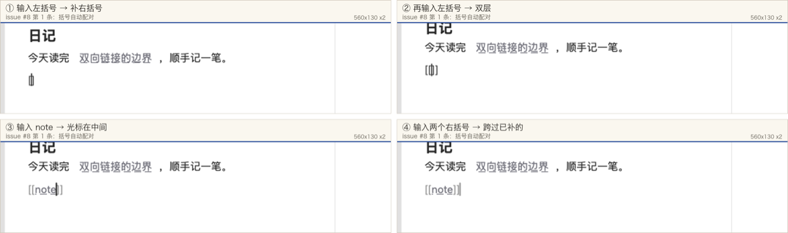
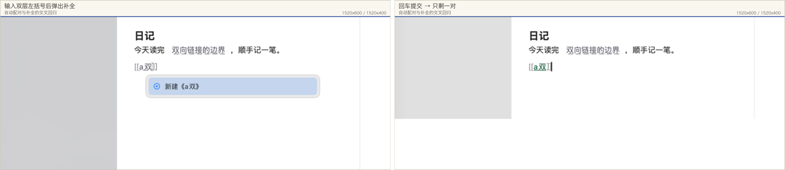
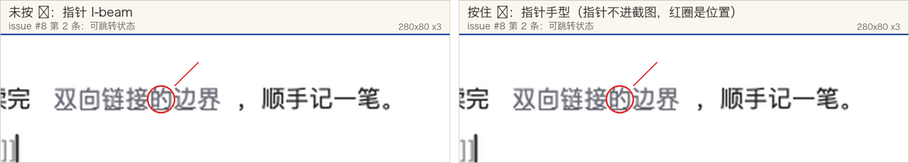

# silvics · issue8-editor-ux 验收报告

## 元信息

| 项 | 值 |
| --- | --- |
| commit | ee31f76 |
| 验收时间 | 2026-11-26 08:33 CST |
| 环境 | macOS 26.1 arm64 / Debug / 1200x800 DPR2 |
| 数据 | vault=/tmp/vault-nav, journal=2026-11-25 |
| 缓存版本 | 待确认 |
| 验收人 | pipi32167 |

## 结论

通过 6 项，不通过 0 项，待确认 0 项，未覆盖 2 项。

## 覆盖用例

| # | 用例 | 判据 | 结果 | 证据 |
| --- | --- | --- | --- | --- |
| 01 | 标题前缀压宽（前后对比） | 修改后标题正文贴在正文左缘，与正文同一列；标题字符一个不少 | 通过 | `artifacts/01-heading-prefix.png` |
| 02 | 标题前缀 2x 细节 | 两图同区域裁剪：修改后标题左缘等于正文左缘，修改前多出一个井号前缀宽 | 通过 | `artifacts/02-heading-zoom.png` |
| 03 | 光标进入标题行露出源码 | 光标所在那行显示井号前缀，其余标题仍压宽；字符一个不少 | 通过 | `artifacts/03-caret-heading.png` |
| 04 | 输入左括号自动补右括号四态 | 每步字符数与光标位置正确：最终只有两对括号，没有多出来的右括号 | 通过 | `artifacts/04-bracket-states.png` |
| 05 | 补全提交不留多余右括号 | 提交后正文与落库原文都是 [[a双]]，不是 [[a双]] 加两个多余括号 | 通过 | `artifacts/05-completion-commit.png` |
| 06 | 按住 ⌘ 悬停引用变手型 | 同一位置：未按 ⌘ 为 I-beam，按住 ⌘ 为手型，移出引用再按 ⌘ 仍是 I-beam | 通过 | `artifacts/06-cmd-hover.png` |

## 偏差清单

| 区域 | 设计稿值 | 实现值 | 判定 | 证据 |
| --- | --- | --- | --- | --- |
| 指针形状的可见证据 | issue 只要求按下 ⌘ 时指针变为可跳转状态，未指定图形 | 行为已跑通；但 screencapture -C 在本机不绘制指针，截图里看不到手型，改用运行时探针作证 | 设计稿未覆盖 | `artifacts/06-cmd-hover.png` |
| 标题前缀压宽后的行内间距 | issue 未标注压宽后标题与正文的间距 | 前缀压到 0 宽，标题正文贴容器左缘，行高与段间距不变 | 设计稿未覆盖 | `artifacts/02-heading-zoom.png` |

## 未覆盖

| 用例 | 原因 |
| --- | --- |
| 深色模式下的标题与标记 | 本轮改的是属性宽度，深浅色共用同一套属性；本轮未单独截图 |
| 中文输入法组合期间输入左括号 | 组合期间不介入该分支由代码守卫覆盖，脚本无法稳定复现组合态 |

## 复现命令

```bash
export DEVELOPER_DIR=/Applications/Xcode.app/Contents/Developer && xcodebuild -project Silvics.xcodeproj -scheme Silvics -configuration Debug -destination "platform=macOS" -derivedDataPath .build CODE_SIGNING_ALLOWED=NO test -only-testing:SilvicsTests/EditorUXTests
SILVICS_SHOW=journal SILVICS_VAULT=/tmp/vault-nav SILVICS_OFFSCREEN=out.png SILVICS_OFFSCREEN_SIZE=1200x800 .build/Build/Products/Debug/Silvics.app/Contents/MacOS/Silvics
SILVICS_CURSOR_PROBE=1 SILVICS_SHOW=journal .build/Build/Products/Debug/Silvics.app/Contents/MacOS/Silvics；移动鼠标到引用上，按下/松开 ⌘，读 /tmp/silvics-debug.log 的 [cursor-probe] 行
```

## 证据图

### 01 标题前缀压宽（前后对比）



[原图](artifacts/01-heading-prefix.png) · 通过 · 差异 11961 px (0.311%) 区块 12 · 判据 修改后标题正文贴在正文左缘，与正文同一列；标题字符一个不少

同一篇日记、同一窗口尺寸、同一 vault；左为修复前构建，右为修复后

### 02 标题前缀 2x 细节



[原图](artifacts/02-heading-zoom.png) · 通过 · 判据 两图同区域裁剪：修改后标题左缘等于正文左缘，修改前多出一个井号前缀宽

状态矩阵 修改前：标题右移约 45px / 修改后：标题与正文同列

### 03 光标进入标题行露出源码



[原图](artifacts/03-caret-heading.png) · 通过 · 判据 光标所在那行显示井号前缀，其余标题仍压宽；字符一个不少

细节放大 1 块 x2

### 04 输入左括号自动补右括号四态



[原图](artifacts/04-bracket-states.png) · 通过 · 判据 每步字符数与光标位置正确：最终只有两对括号，没有多出来的右括号

真键盘事件（System Events keystroke）逐字输入，不是脚本注入

### 05 补全提交不留多余右括号



[原图](artifacts/05-completion-commit.png) · 通过 · 判据 提交后正文与落库原文都是 [[a双]]，不是 [[a双]] 加两个多余括号

库里 select body 验证：[[a双]]

### 06 按住 ⌘ 悬停引用变手型



[原图](artifacts/06-cmd-hover.png) · 通过 · 判据 同一位置：未按 ⌘ 为 I-beam，按住 ⌘ 为手型，移出引用再按 ⌘ 仍是 I-beam

指针形状 screencapture -C 在本机不绘制，故补运行时探针：cmd=true overLink=true cursor=hand

## 截图清单

| 文件 | 说明 | 差异 |
| --- | --- | --- |
| `artifacts/01-heading-prefix.png` | 同一篇日记、同一窗口尺寸、同一 vault；左为修复前构建，右为修复后 | 差异 11961 px (0.311%) 区块 12 |
| `artifacts/02-heading-zoom.png` | 状态矩阵 修改前：标题右移约 45px / 修改后：标题与正文同列 | — |
| `artifacts/03-caret-heading.png` | 细节放大 1 块 x2 | — |
| `artifacts/04-bracket-states.png` | 真键盘事件（System Events keystroke）逐字输入，不是脚本注入 | — |
| `artifacts/05-completion-commit.png` | 库里 select body 验证：[[a双]] | — |
| `artifacts/06-cmd-hover.png` | 指针形状 screencapture -C 在本机不绘制，故补运行时探针：cmd=true overLink=true cursor=hand | — |
