# silvics · ime-render-v0.8.1 验收报告

## 元信息

| 项 | 值 |
| --- | --- |
| commit | 2cf5f74 |
| 验收时间 | 2026-11-27 17:29 CST |
| 环境 | macOS 27 / Xcode 27.2 / Swift 6.4 / Debug / App Sandbox 关 |
| 数据 | SILVICS_DB 临时库 + SILVICS_SEED=1；自检把一篇含各类 markdown 的正文装进编辑区 |
| 缓存版本 | SPM SourcePackages 复用，DerivedData .build |
| 验收人 | pi |

## 结论

通过 7 项，不通过 0 项，待确认 0 项，未覆盖 4 项。

## 覆盖用例

| # | 用例 | 判据 | 结果 | 证据 |
| --- | --- | --- | --- | --- |
| 01 | 01 组字中：整窗前后对比 | 组字期间：组字行不出现复选框；其余每条待办都在自己那一行且勾选态与本行是否打勾一致 | 通过 | `artifacts/01-组字中-整窗.png` |
| 04 | 02 组字中：复选框细节 2x 放大 | 逐行核对：已完成的一组打勾 / 未完成的另一组空框 / 拿口罩打勾 / 买牛奶空框 / 迁移打勾 / 修改空框；组字行不该有方框 | 通过 | `artifacts/02-组字中-复选框2x细节.png` |
| 05 | 03 组字换行：整窗前后对比 | 组字串长到换行、下面整体下移时：复选框跟着下移并保持各自勾选态；引用竖线、代码块底色不跑到别的段落 | 通过 | `artifacts/03-组字换行-整窗.png` |
| 08 | 04 组字换行：引用竖线 / 方框细节 2x | 工作区三条待办各自带方框、勾选态与正文一致；引用竖线只画在引用块左侧；生活标题左侧无方框 | 通过 | `artifacts/04-引用竖线与复选框-2x细节.png` |
| 09 | 05 新实现：渲染态 → 组字中 → 上屏后 | 三态下待办方框数量、位置、勾选态一致；组字中只有组字那一行露源码；上屏后回到渲染态 | 通过 | `artifacts/05-新实现-状态矩阵.png` |
| 12 | 06 其他 markdown 组件：组字前后渲染不变 | 引用（竖线 + 次级色）、行内代码（等宽 + 底色）、粗体、斜体、引用链接（下划线）、表格（等宽 + pipe 对齐）、代码块（底色 + 关键字上色）在组字前后逐项一致 | 通过 | `artifacts/06-其他组件-组字前后.png` |
| 15 | 07 行内强调 / 行内代码：块引用懒惰续行的区间修正 4x | 行内代码的反引号、双星号粗体、单星号斜体的定界符全部隐藏，只剩等宽底色与粗体 / 斜体字形；正文一个字符不改 | 通过 | `artifacts/07-行内强调-区间修正4x.png` |

## 偏差清单

无。

## 未覆盖

| 用例 | 原因 |
| --- | --- |
| 系统拼音输入法真机敲字 | 本机 TISSelectInputSource 返回 -50（paramErr），进程内外都切不到简体拼音输入源（同 issue #34 记录）。自检按 NSTextInputClient 协议（setMarkedText → insertText）等价驱动编辑区，仍需人工在系统拼音下敲一次确认 |
| 深色外观 | 缺陷是「偏移过期导致装饰画错行」，与配色无关；本次未取深色图 |
| 表格行内组字 | 表格块要光标行撤 kern 才露源码，组字与表格 kern 的组合本次未单独取图；由 06 的表格区间核对与 R08 的区间用例覆盖 |
| 窄 / 宽窗口断点 | 只取 900x1050 一种窗口宽度；换行触发靠 05 的长组字串覆盖，未做多断点矩阵 |

## 复现命令

```bash
xcodebuild -project Silvics.xcodeproj -scheme Silvics -configuration Debug -destination "platform=macOS" -derivedDataPath .build CODE_SIGNING_ALLOWED=NO -only-testing:SilvicsTests/EditorComposeRenderTests -only-testing:SilvicsTests/StylerTests test
SILVICS_DB=/tmp/ab/db.sqlite SILVICS_VAULT=/tmp/ab/vault SILVICS_SEED=1 SILVICS_SELFTEST=ime-render SILVICS_CAPTURE=/tmp/ab/shot.png SILVICS_QUIT_AFTER_SELFTEST=1 .build/Build/Products/Debug/Silvics.app/Contents/MacOS/Silvics
```

## 证据图

### 01 01 组字中：整窗前后对比

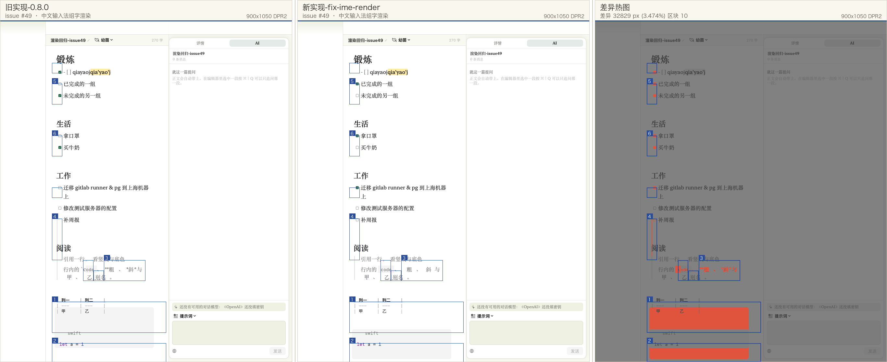

[原图](artifacts/01-组字中-整窗.png) · 通过 · 差异 32829 px (3.474%) 区块 10 · 判据 组字期间：组字行不出现复选框；其余每条待办都在自己那一行且勾选态与本行是否打勾一致

旧实现：组字行多出一个勾选方框，下面七条待办整体串态一格；新实现全部对上

### 细节放大 1 块 x2

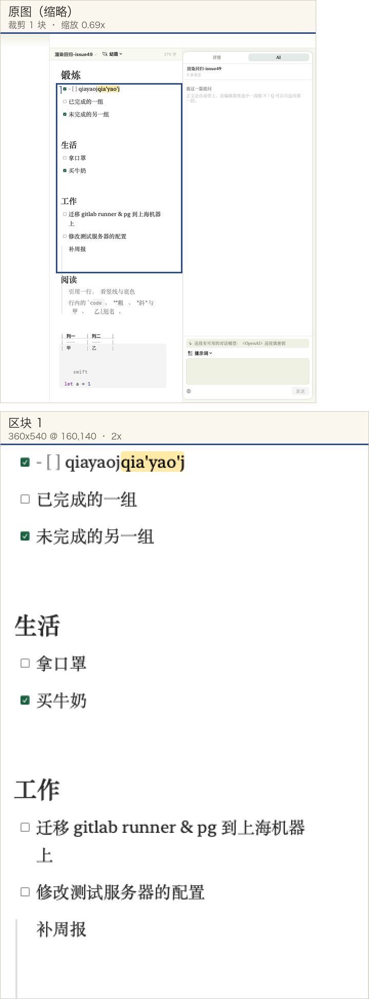

[原图](artifacts/02-raw-旧实现-裁剪.png) · 

### 细节放大 1 块 x2

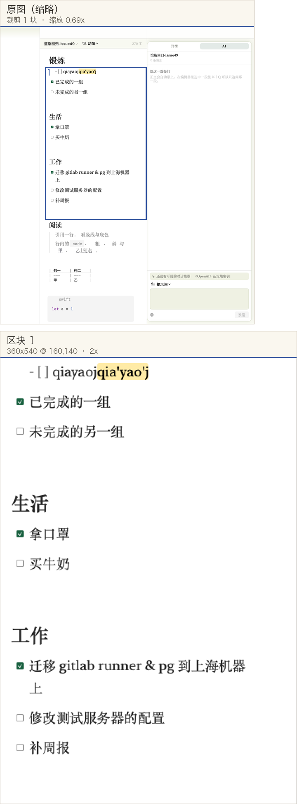

[原图](artifacts/02-raw-新实现-裁剪.png) · 

### 04 02 组字中：复选框细节 2x 放大

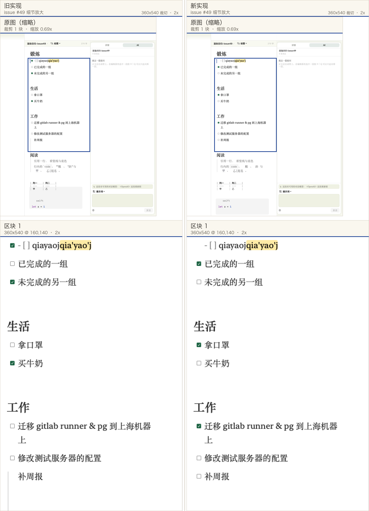

[原图](artifacts/02-组字中-复选框2x细节.png) · 通过 · 判据 逐行核对：已完成的一组打勾 / 未完成的另一组空框 / 拿口罩打勾 / 买牛奶空框 / 迁移打勾 / 修改空框；组字行不该有方框

旧实现从组字行开始整体串一格；新实现七个方框全部落回自己那一行

### 05 03 组字换行：整窗前后对比

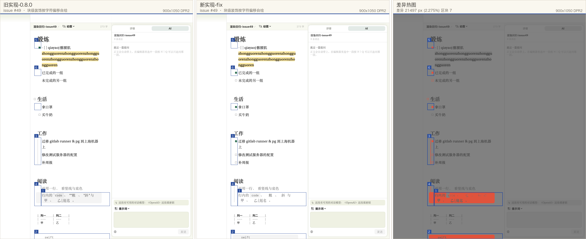

[原图](artifacts/03-组字换行-整窗.png) · 通过 · 差异 21497 px (2.275%) 区块 7 · 判据 组字串长到换行、下面整体下移时：复选框跟着下移并保持各自勾选态；引用竖线、代码块底色不跑到别的段落

旧实现：七个方框全挤到组字那一行，生活标题左边多出一个方框，工作区冒出一条竖线；新实现全部归位

### 细节放大 1 块 x2

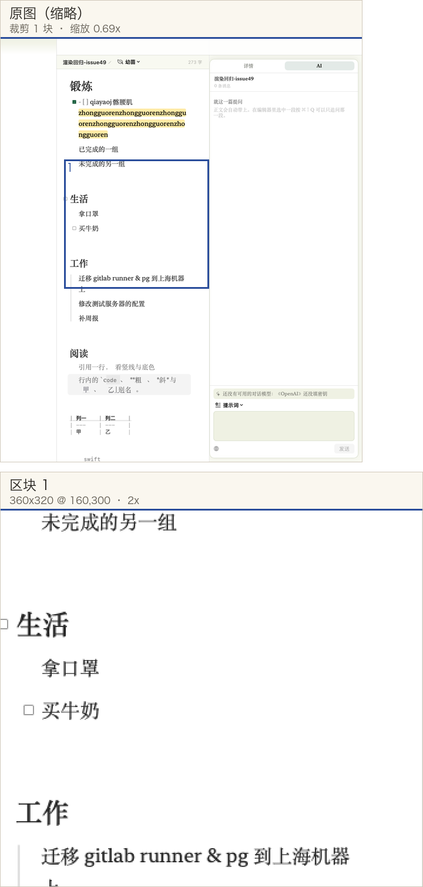

[原图](artifacts/04-raw-旧实现-裁剪.png) · 

### 细节放大 1 块 x2

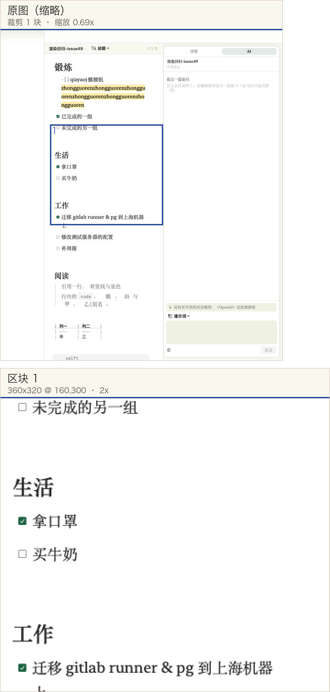

[原图](artifacts/04-raw-新实现-裁剪.png) · 

### 08 04 组字换行：引用竖线 / 方框细节 2x

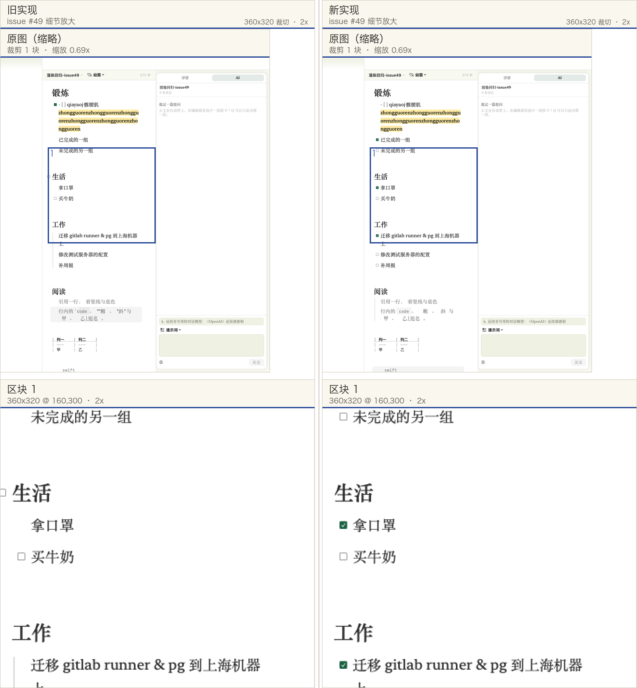

[原图](artifacts/04-引用竖线与复选框-2x细节.png) · 通过 · 判据 工作区三条待办各自带方框、勾选态与正文一致；引用竖线只画在引用块左侧；生活标题左侧无方框

旧实现竖线串到工作区、方框堆在组字行；新实现竖线回到引用块、方框归位

### 09 05 新实现：渲染态 → 组字中 → 上屏后

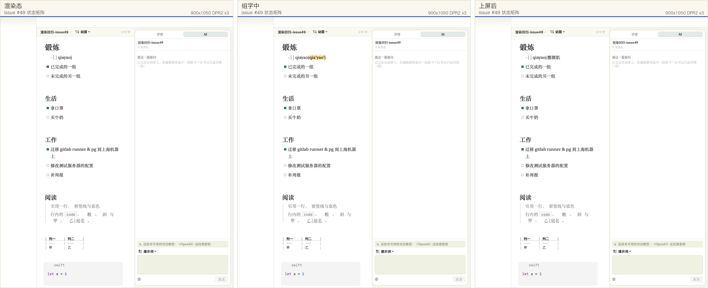

[原图](artifacts/05-新实现-状态矩阵.png) · 通过 · 判据 三态下待办方框数量、位置、勾选态一致；组字中只有组字那一行露源码；上屏后回到渲染态

组字不改渲染，只改正文；三态画面除组字行外一致

### 细节放大 1 块 x2

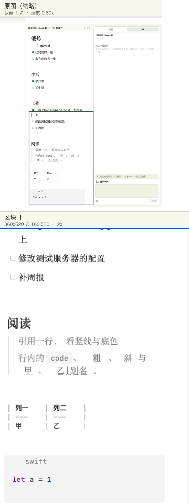

[原图](artifacts/06-raw-组字前-裁剪.png) · 

### 细节放大 1 块 x2


[原图](artifacts/06-raw-组字中-裁剪.png) · 

### 12 06 其他 markdown 组件：组字前后渲染不变

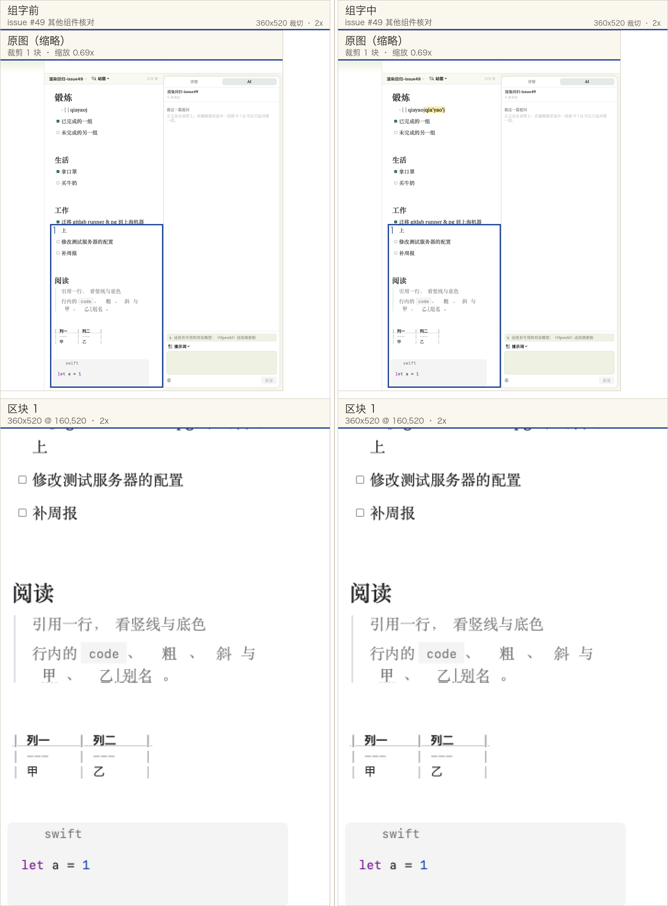

[原图](artifacts/06-其他组件-组字前后.png) · 通过 · 判据 引用（竖线 + 次级色）、行内代码（等宽 + 底色）、粗体、斜体、引用链接（下划线）、表格（等宽 + pipe 对齐）、代码块（底色 + 关键字上色）在组字前后逐项一致

裁切区为工作 / 阅读 / 表格 / 代码块；差异只在组字行，下面组件零改动

### 细节放大 1 块 x4

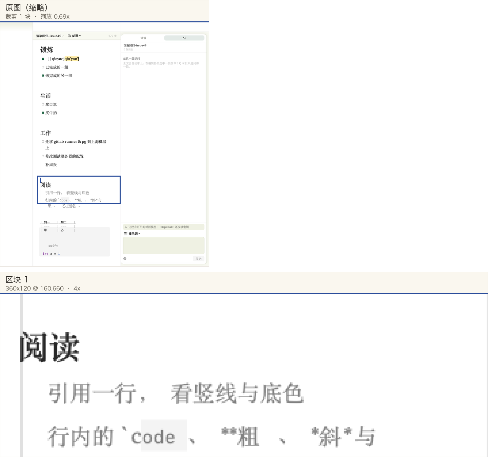

[原图](artifacts/07-raw-旧实现-裁剪.png) · 

### 细节放大 1 块 x4

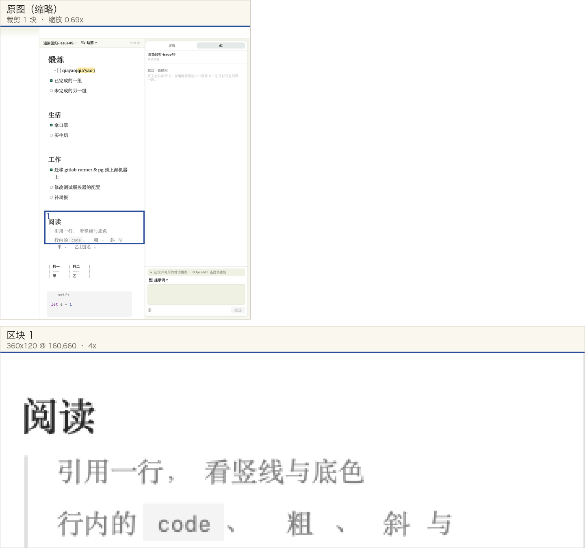

[原图](artifacts/07-raw-新实现-裁剪.png) · 

### 15 07 行内强调 / 行内代码：块引用懒惰续行的区间修正 4x

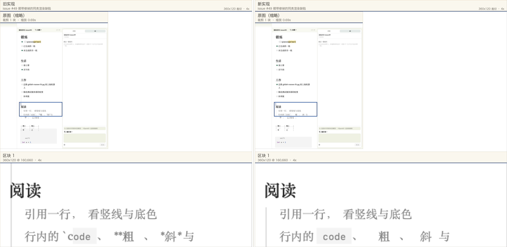

[原图](artifacts/07-行内强调-区间修正4x.png) · 通过 · 判据 行内代码的反引号、双星号粗体、单星号斜体的定界符全部隐藏，只剩等宽底色与粗体 / 斜体字形；正文一个字符不改

旧实现整行右移两位：露出双星号与单星号，粗体落到「粗 + 两个星号」上；新实现定界符全部隐藏

## 截图清单

| 文件 | 说明 | 差异 |
| --- | --- | --- |
| `artifacts/01-组字中-整窗.png` | 旧实现：组字行多出一个勾选方框，下面七条待办整体串态一格；新实现全部对上 | 差异 32829 px (3.474%) 区块 10 |
| `artifacts/02-raw-旧实现-裁剪.png` | 细节放大 1 块 x2 | — |
| `artifacts/02-raw-新实现-裁剪.png` | 细节放大 1 块 x2 | — |
| `artifacts/02-组字中-复选框2x细节.png` | 旧实现从组字行开始整体串一格；新实现七个方框全部落回自己那一行 | — |
| `artifacts/03-组字换行-整窗.png` | 旧实现：七个方框全挤到组字那一行，生活标题左边多出一个方框，工作区冒出一条竖线；新实现全部归位 | 差异 21497 px (2.275%) 区块 7 |
| `artifacts/04-raw-旧实现-裁剪.png` | 细节放大 1 块 x2 | — |
| `artifacts/04-raw-新实现-裁剪.png` | 细节放大 1 块 x2 | — |
| `artifacts/04-引用竖线与复选框-2x细节.png` | 旧实现竖线串到工作区、方框堆在组字行；新实现竖线回到引用块、方框归位 | — |
| `artifacts/05-新实现-状态矩阵.png` | 组字不改渲染，只改正文；三态画面除组字行外一致 | — |
| `artifacts/06-raw-组字前-裁剪.png` | 细节放大 1 块 x2 | — |
| `artifacts/06-raw-组字中-裁剪.png` | 细节放大 1 块 x2 | — |
| `artifacts/06-其他组件-组字前后.png` | 裁切区为工作 / 阅读 / 表格 / 代码块；差异只在组字行，下面组件零改动 | — |
| `artifacts/07-raw-旧实现-裁剪.png` | 细节放大 1 块 x4 | — |
| `artifacts/07-raw-新实现-裁剪.png` | 细节放大 1 块 x4 | — |
| `artifacts/07-行内强调-区间修正4x.png` | 旧实现整行右移两位：露出双星号与单星号，粗体落到「粗 + 两个星号」上；新实现定界符全部隐藏 | — |
