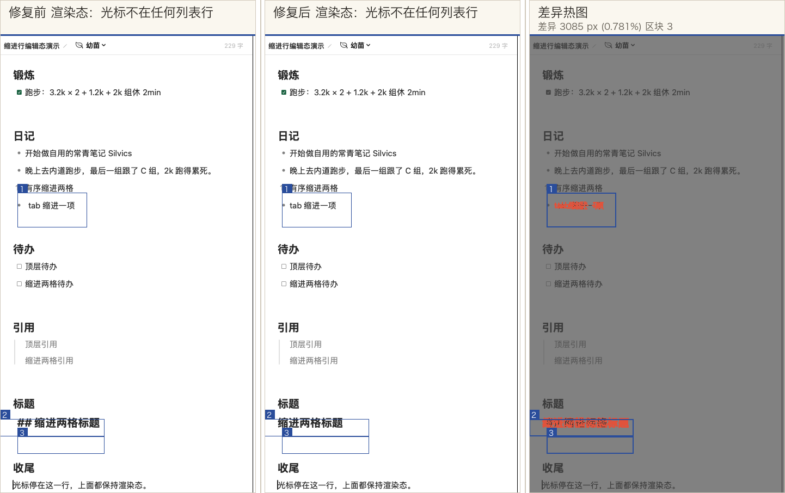
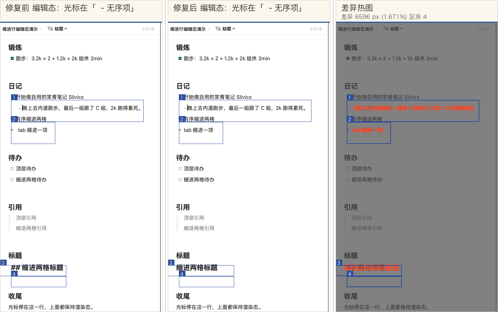
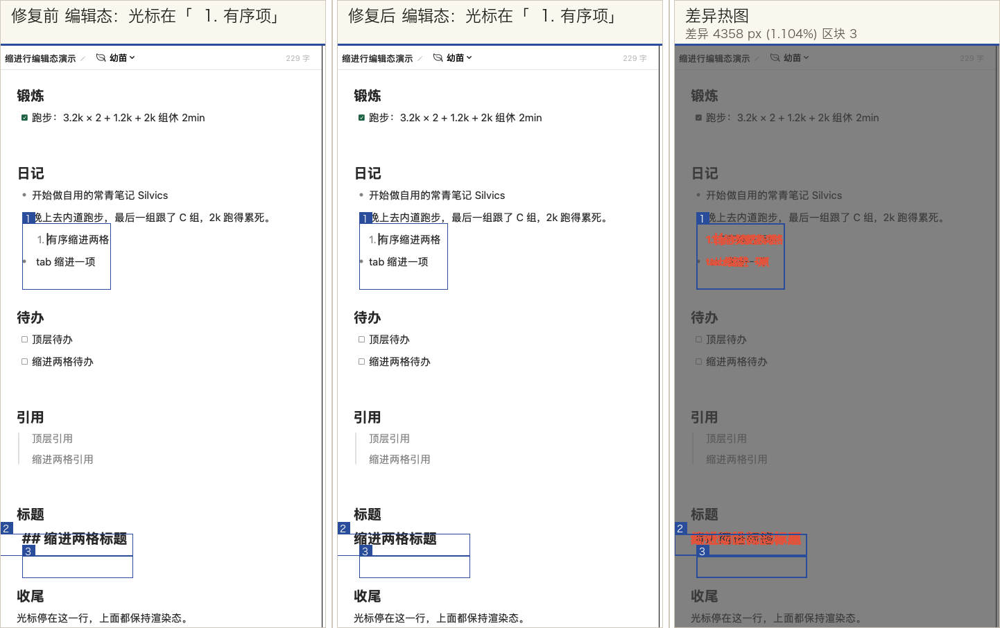
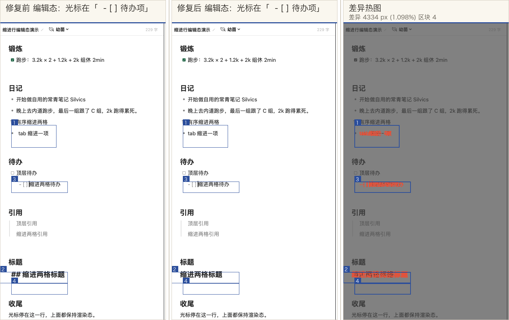
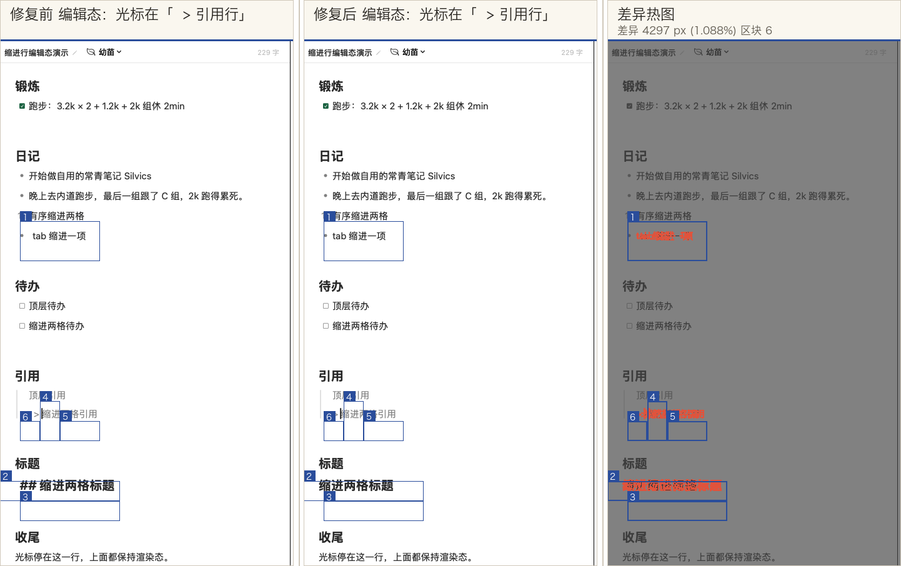
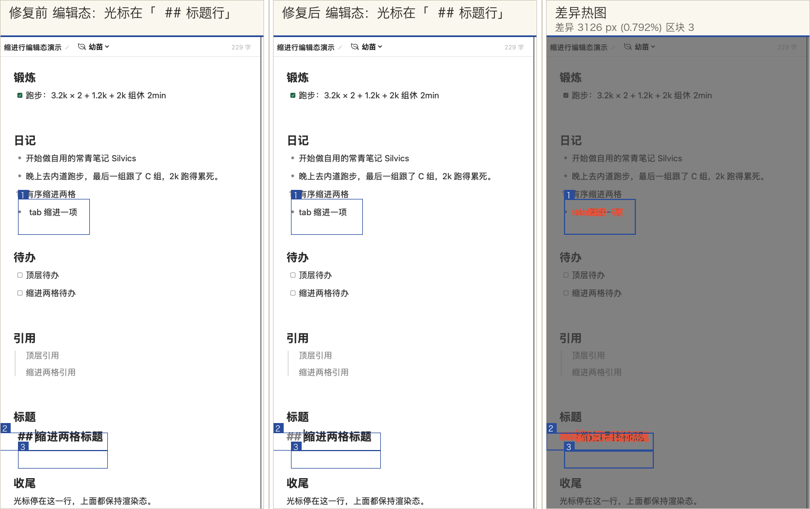
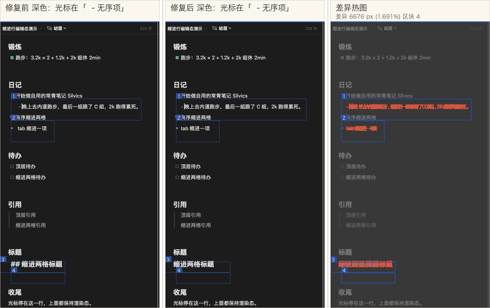
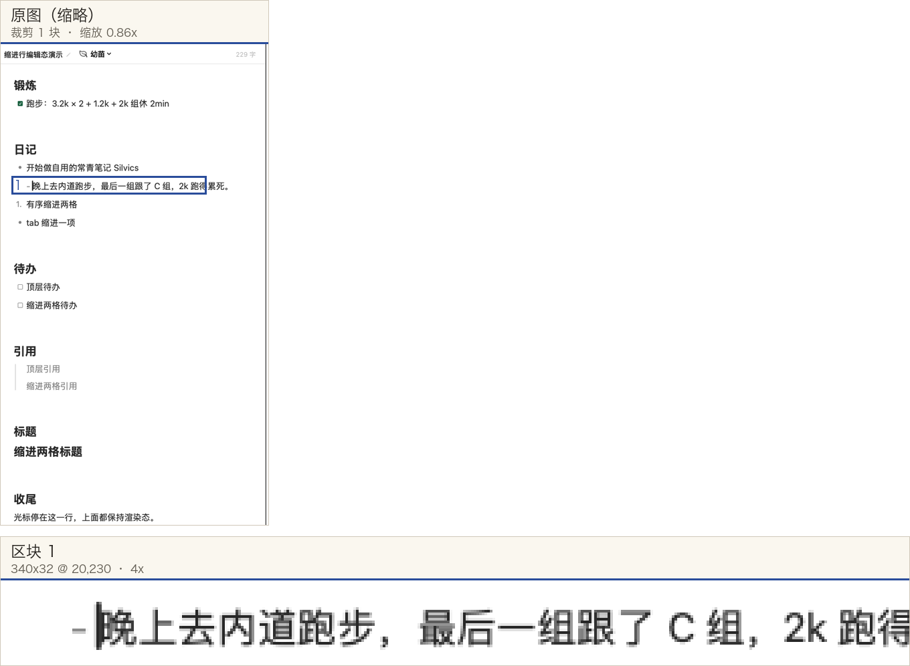
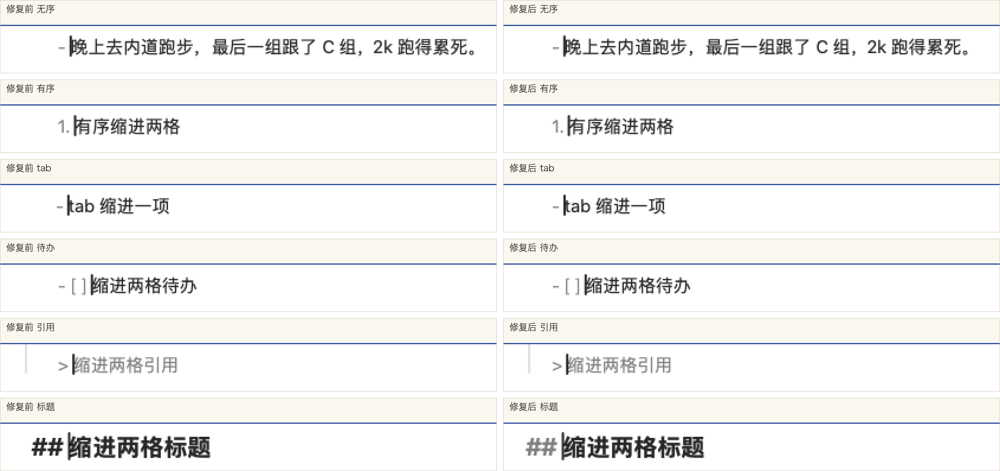

# silvics · fix/list-indent-issue41 验收报告

## 元信息

| 项 | 值 |
| --- | --- |
| commit | 4a47659+worktree |
| 验收时间 | 2026-11-26 16:26 CST |
| 环境 | macOS 27 / Apple 芯片 / Debug 构建 / 窗口 900x1200 |
| 数据 | vault=/tmp/vault-indent，演示笔记《缩进行编辑态演示》（SILVICS_SHOW=indent 播种） |
| 缓存版本 | 不适用（本 issue 无缓存层） |
| 验收人 | pi agent |

## 结论

通过 10 项，不通过 0 项，待确认 0 项，未覆盖 3 项。

## 覆盖用例

| # | 用例 | 判据 | 结果 | 证据 |
| --- | --- | --- | --- | --- |
| 01 | 渲染态：光标不在任何列表行 | 五类前缀（无序 / 有序 / 待办 / tab / 引用）的正文左缘都落在同一缩进；正文一个字符不改 | 通过 | `artifacts/01-渲染态.png` |
| 02 | 编辑态：光标在「  - 无序项」 | 行首两个空格不占宽：光标行正文左缘 = 列表缩进 + `- ` 宽度 | 通过 | `artifacts/02-无序缩进.png` |
| 03 | 编辑态：光标在「  1. 有序项」 | 有序前缀前同样不留行首空白，正文左缘与用例 02 一致 | 通过 | `artifacts/03-有序缩进.png` |
| 04 | 编辑态：光标在「\t- tab 项」 | tab 缩进不占宽（制表位压到 0.1 pt），正文左缘与空格缩进相同 | 通过 | `artifacts/04-tab缩进.png` |
| 05 | 编辑态：光标在「  - [ ] 待办项」 | 待办前缀 `- [ ] ` 之前不留行首空白 | 通过 | `artifacts/05-待办缩进.png` |
| 06 | 编辑态：光标在「  > 引用行」 | 引用行首两个空格不占宽，`>` 落在引用缩进处（22 pt） | 通过 | `artifacts/06-引用缩进.png` |
| 07 | 编辑态：光标在「  ## 标题行」 | ≤3 个前导空格的标题按标题渲染，前导空格不占宽 | 通过 | `artifacts/07-标题缩进.png` |
| 08 | 深色：光标在「  - 无序项」 | 深色外观下结论与用例 02 一致：行首空白不占宽 | 通过 | `artifacts/08-深色-无序缩进.png` |
| 09 | 4x 放大：光标行前缀只剩 `- ` | 放大 4 倍能看清：行首第一个字形是 `-`，其后一个空格，再后是正文；没有多余空白 | 通过 | `artifacts/09-4x-光标行前缀.png` |
| 10 | 状态矩阵：六类前缀的编辑态对照 | 每一行左格行首空白可见、正文右移；右格只剩语法标记，正文左缘一致 | 通过 | `artifacts/10-状态矩阵-六类前缀.png` |

## 偏差清单

| 区域 | 设计稿值 | 实现值 | 判定 | 证据 |
| --- | --- | --- | --- | --- |
| 列表 / 引用段落里行中间的 tab | 按制表位对齐 | 制表位被清空、默认间隔压到 0.1 pt，行中间的 tab 不再跳格 | 待确认 | `artifacts/04-tab缩进.png` |
| 行首缩进（2 / 4 个空格） | 光标段落露出完整的 `  - ` 原始前缀（issue #23 原计划） | 只露 `- `，缩进永远不占宽 | 已修复 | `artifacts/02-无序缩进.png` |

## 未覆盖

| 用例 | 原因 |
| --- | --- |
| 中文输入法组合态下改行首缩进 | 需要真实输入法与真机交互；组合期间编辑器不改属性的逻辑未变，本 issue 只改属性写法 |
| 嵌套列表的多级缩进（issue #23） | 缩进仍不参与层级布局：本 issue 只保证它不占宽，多级符号与层层缩进是 #23 的范围 |
| 4 个空格缩进的标题 | CommonMark 里 4 个空格是缩进代码块，仍按原文显示（`  ## ` 才算标题）；已在单元用例 S53 里钉住 |

## 复现命令

```bash
cd ~/work/dev/Silvics-indent && export DEVELOPER_DIR=/Applications/Xcode.app/Contents/Developer && xcodebuild -project Silvics.xcodeproj -scheme Silvics -configuration Debug -destination 'platform=macOS' -derivedDataPath .build test -only-testing:SilvicsTests/EditorIndentTests
open .build/Build/Products/Debug/Silvics.app --env SILVICS_DB=/tmp/indent-db/silvics.sqlite --env SILVICS_VAULT=/tmp/vault-indent --env SILVICS_SHOW=indent --env SILVICS_SELECT=缩进行编辑态演示 --env SILVICS_CARET='晚上去内道跑步' --env SILVICS_CAPTURE=/tmp/shots-indent/02.png --env SILVICS_WINDOW=900x1200
```

## 证据图

### 01 渲染态：光标不在任何列表行



[原图](artifacts/01-渲染态.png) · 通过 · 差异 3085 px (0.781%) 区块 3 · 判据 五类前缀（无序 / 有序 / 待办 / tab / 引用）的正文左缘都落在同一缩进；正文一个字符不改

光标停在收尾行，其余行都是渲染态。差异只有「缩进两格标题」：修复前露原文 `## `，修复后按 S53 变成标题（见 07）。

### 02 编辑态：光标在「  - 无序项」



[原图](artifacts/02-无序缩进.png) · 通过 · 差异 6596 px (1.671%) 区块 4 · 判据 行首两个空格不占宽：光标行正文左缘 = 列表缩进 + `- ` 宽度

左图行首空白按原宽显示，正文整体右移 8 pt；右图只剩 `- `。

### 03 编辑态：光标在「  1. 有序项」



[原图](artifacts/03-有序缩进.png) · 通过 · 差异 4358 px (1.104%) 区块 3 · 判据 有序前缀前同样不留行首空白，正文左缘与用例 02 一致

序号是原文的 `1. `，不重排、不补齐（S38）。

### 04 编辑态：光标在「\t- tab 项」


[原图](artifacts/04-tab缩进.png) · 通过 · 差异 3185 px (0.807%) 区块 3 · 判据 tab 缩进不占宽（制表位压到 0.1 pt），正文左缘与空格缩进相同

tab 走制表位，字号与 kern 都压不住，必须单独摘掉制表位。

### 05 编辑态：光标在「  - [ ] 待办项」



[原图](artifacts/05-待办缩进.png) · 通过 · 差异 4334 px (1.098%) 区块 4 · 判据 待办前缀 `- [ ] ` 之前不留行首空白

光标行按 S40 不画复选框浮层，露 `- [ ] ` 源码。

### 06 编辑态：光标在「  > 引用行」



[原图](artifacts/06-引用缩进.png) · 通过 · 差异 4297 px (1.088%) 区块 6 · 判据 引用行首两个空格不占宽，`>` 落在引用缩进处（22 pt）

引用段落本身有 22 pt 缩进（`Theme.quoteParagraph`），本用例只针对行首额外空格。

### 07 编辑态：光标在「  ## 标题行」



[原图](artifacts/07-标题缩进.png) · 通过 · 差异 3126 px (0.792%) 区块 3 · 判据 ≤3 个前导空格的标题按标题渲染，前导空格不占宽

修复前 `  ## 缩进两格标题` 不识别成标题，整行按正文露原文；修复后按 CommonMark 识别。

### 08 深色：光标在「  - 无序项」



[原图](artifacts/08-深色-无序缩进.png) · 通过 · 差异 6676 px (1.691%) 区块 4 · 判据 深色外观下结论与用例 02 一致：行首空白不占宽

深色外观（SILVICS_DARK=1）。只截编辑区：右侧上下文面板的深色适配不在本 issue 范围。

### 09 4x 放大：光标行前缀只剩 `- `



[原图](artifacts/09-4x-光标行前缀.png) · 通过 · 判据 放大 4 倍能看清：行首第一个字形是 `-`，其后一个空格，再后是正文；没有多余空白

细节放大 1 块 x4

### 10 状态矩阵：六类前缀的编辑态对照



[原图](artifacts/10-状态矩阵-六类前缀.png) · 通过 · 判据 每一行左格行首空白可见、正文右移；右格只剩语法标记，正文左缘一致

光标行裁剪后放大 3 倍，每格 40 px 高。

## 截图清单

| 文件 | 说明 | 差异 |
| --- | --- | --- |
| `artifacts/01-渲染态.png` | 光标停在收尾行，其余行都是渲染态。差异只有「缩进两格标题」：修复前露原文 `## `，修复后按 S53 变成标题（见 07）。 | 差异 3085 px (0.781%) 区块 3 |
| `artifacts/02-无序缩进.png` | 左图行首空白按原宽显示，正文整体右移 8 pt；右图只剩 `- `。 | 差异 6596 px (1.671%) 区块 4 |
| `artifacts/03-有序缩进.png` | 序号是原文的 `1. `，不重排、不补齐（S38）。 | 差异 4358 px (1.104%) 区块 3 |
| `artifacts/04-tab缩进.png` | tab 走制表位，字号与 kern 都压不住，必须单独摘掉制表位。 | 差异 3185 px (0.807%) 区块 3 |
| `artifacts/05-待办缩进.png` | 光标行按 S40 不画复选框浮层，露 `- [ ] ` 源码。 | 差异 4334 px (1.098%) 区块 4 |
| `artifacts/06-引用缩进.png` | 引用段落本身有 22 pt 缩进（`Theme.quoteParagraph`），本用例只针对行首额外空格。 | 差异 4297 px (1.088%) 区块 6 |
| `artifacts/07-标题缩进.png` | 修复前 `  ## 缩进两格标题` 不识别成标题，整行按正文露原文；修复后按 CommonMark 识别。 | 差异 3126 px (0.792%) 区块 3 |
| `artifacts/08-深色-无序缩进.png` | 深色外观（SILVICS_DARK=1）。只截编辑区：右侧上下文面板的深色适配不在本 issue 范围。 | 差异 6676 px (1.691%) 区块 4 |
| `artifacts/09-4x-光标行前缀.png` | 细节放大 1 块 x4 | — |
| `artifacts/10-状态矩阵-六类前缀.png` | 光标行裁剪后放大 3 倍，每格 40 px 高。 | — |
