# silvics · feat-nav-d 验收报告

## 元信息

| 项 | 值 |
| --- | --- |
| commit | 8d647fa |
| 验收时间 | 2026-11-26 06:52 CST |
| 环境 | macOS 26 / 1440x900 与 900x820 / 2x 渲染 |
| 数据 | 待确认 |
| 缓存版本 | 待确认 |
| 验收人 | agent |

## 结论

通过 14 项，不通过 0 项，待确认 0 项，未覆盖 2 项。

## 覆盖用例

| # | 用例 | 判据 | 结果 | 证据 |
| --- | --- | --- | --- | --- |
| 01 | 主窗口骨架：三栏 → 四栏 | 四栏可见：模块导航 / 列表 / 内容 / 右栏；模块行与二级导航分开 | 通过 | `artifacts/01-before-after.png` |
| 02 | 列表栏收起/展开 | 收起后列表栏消失、内容区变宽、选中条目不变 | 通过 | `artifacts/02-list-collapse.png` |
| 03 | 窄窗口退化 | 窄于 1000px 自动收起列表栏；手动展开后右栏压窄而不是消失 | 通过 | `artifacts/03-narrow.png` |
| 04 | 三个模块的二级导航 | 每模块有自己的范围与标签；切换后列表、内容、右栏同时更新 | 通过 | `artifacts/04-modules.png` |
| 05 | 剪藏范围：未读 / 待整理 / 标签 | 待整理只含 aiState != done；标签只在剪藏模块出现 | 通过 | `artifacts/05-clip-scopes.png` |
| 06 | 标签按模块分开 | 笔记模块只列笔记标签，剪藏模块只列剪藏标签 | 通过 | `artifacts/06-tags.png` |
| 07 | 待办总览与模板搬进中栏 | 两页都占满中栏，不弹 sheet；右栏给说明 | 通过 | `artifacts/07-todos-templates.png` |
| 08 | 快捷键：⌘1 / ⌘2 / ⌘3 | 三条都切到对应模块，四栏内容一起换 | 通过 | `artifacts/08-shortcut-module.png` |
| 09 | 快捷键：⌘N / ⌘⇧J / ⌘⇧L | ⌘N 按模块分流；⌘⇧J 定位今天；⌘⇧L 定位剪藏未读 | 通过 | `artifacts/09-shortcut-actions.png` |
| 10 | 快捷键：⌘⇧T / ⌘, | ⌘⇧T 切到中栏待办总览；⌘, 打开独立设置窗口 | 通过 | `artifacts/10-shortcut-todos-settings.png` |
| 11 | 三模块空态 | 空态文案按模块给，不出现「没有选中笔记」 | 通过 | `artifacts/11-empty-states.png` |
| 12 | 搜索只搜当前模块 | 同一搜索词只在本模块出结果，「只搜笔记 / 含日记」开关已删 | 通过 | `artifacts/12-search-scope.png` |
| 13 | 日记右栏：当天统计 | 右栏给出日期、星期、未完成条数、承接自、字数，并保留反向链接与提及开关 | 通过 | `artifacts/13-journal-context-2x.png` |
| 14 | 列表栏宽度可拖且记忆 | 拖到 300 后宽度落盘，重开还原；越界钳在 200–360 | 通过 | `artifacts/14-list-width.png` |

## 偏差清单

| 区域 | 设计稿值 | 实现值 | 判定 | 证据 |
| --- | --- | --- | --- | --- |
| 窄窗口下的右栏 | 原型直接隐藏右栏 | 改成压窄：右栏保留，最小 200px，四栏都在 | 已修复 | `artifacts/03-narrow.png` |
| 列表栏宽度 | 原型可拖动分隔条，宽度跟手 | 自绘分隔条，宽度落 UserDefaults，重开还原，越界钳 200–360 | 已修复 | `artifacts/14-list-width.png` |

## 未覆盖

| 用例 | 原因 |
| --- | --- |
| 深色模式 | 本轮只拍浅色，深色留到发版前统一过一遍 |
| 1200px 中间档 | 只拍 1440 与 900 两档，1020-1440 的四栏压紧没单独取证 |

## 复现命令

```bash
cd ~/work/dev/Silvics && SILVICS_VAULT=/tmp/vault-nav SILVICS_OFFSCREEN=/tmp/shot.png SILVICS_OFFSCREEN_SIZE=1440x900 SILVICS_SHOW=<值> .build/Build/Products/Debug/Silvics.app/Contents/MacOS/Silvics；值取 module-notes / journal / clip-unread / clips-pending / journal-todos / journal-templates-nav / list-collapsed / list-expanded；列表栏宽度用 SILVICS_LIST_WIDTH=300
```

## 证据图

### 01 主窗口骨架：三栏 → 四栏

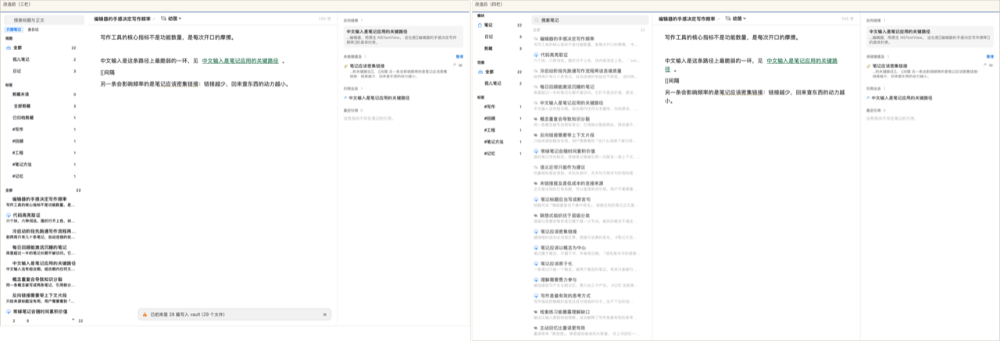

[原图](artifacts/01-before-after.png) · 通过 · 判据 四栏可见：模块导航 / 列表 / 内容 / 右栏；模块行与二级导航分开

同一演示 vault

### 02 列表栏收起/展开

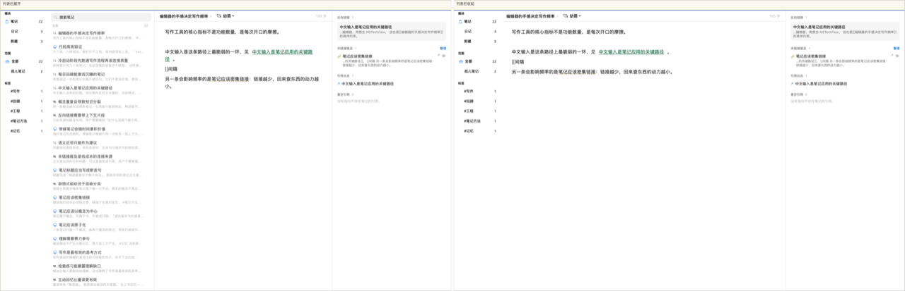

[原图](artifacts/02-list-collapse.png) · 通过 · 判据 收起后列表栏消失、内容区变宽、选中条目不变

状态矩阵 列表栏展开 / 列表栏收起

### 03 窄窗口退化

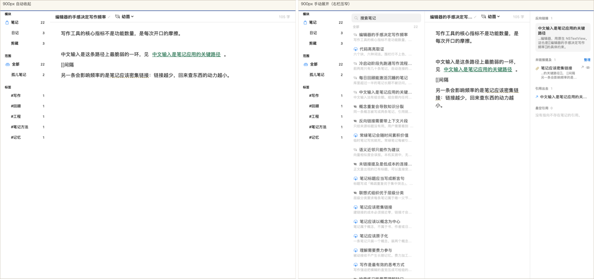

[原图](artifacts/03-narrow.png) · 通过 · 判据 窄于 1000px 自动收起列表栏；手动展开后右栏压窄而不是消失

900x820

### 04 三个模块的二级导航

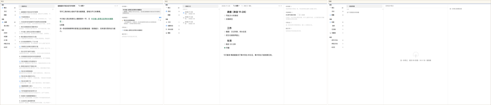

[原图](artifacts/04-modules.png) · 通过 · 判据 每模块有自己的范围与标签；切换后列表、内容、右栏同时更新

状态矩阵 笔记 / 日记 / 剪藏

### 05 剪藏范围：未读 / 待整理 / 标签

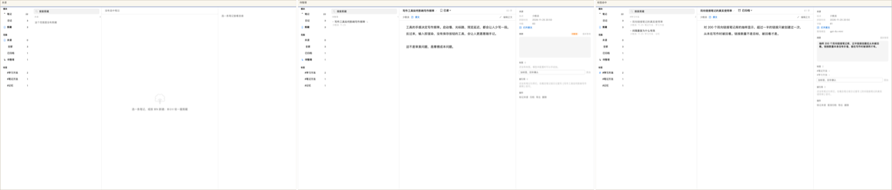

[原图](artifacts/05-clip-scopes.png) · 通过 · 判据 待整理只含 aiState != done；标签只在剪藏模块出现

状态矩阵 未读 / 待整理 / 标签命中

### 06 标签按模块分开

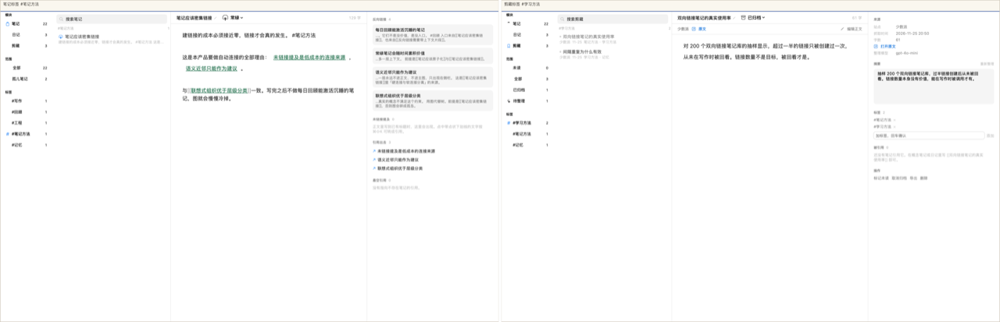

[原图](artifacts/06-tags.png) · 通过 · 判据 笔记模块只列笔记标签，剪藏模块只列剪藏标签

状态矩阵 笔记标签 #笔记方法 / 剪藏标签 #学习方法

### 07 待办总览与模板搬进中栏

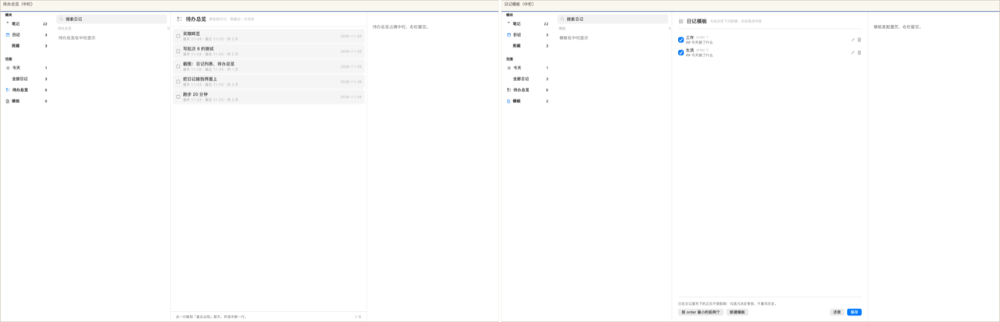

[原图](artifacts/07-todos-templates.png) · 通过 · 判据 两页都占满中栏，不弹 sheet；右栏给说明

状态矩阵 待办总览（中栏） / 日记模板（中栏）

### 08 快捷键：⌘1 / ⌘2 / ⌘3

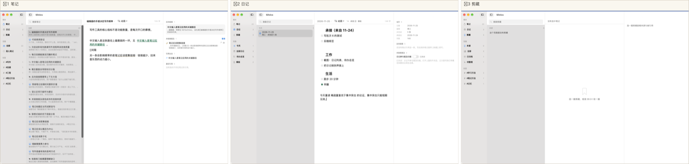

[原图](artifacts/08-shortcut-module.png) · 通过 · 判据 三条都切到对应模块，四栏内容一起换

状态矩阵 ⌘1 笔记 / ⌘2 日记 / ⌘3 剪藏

### 09 快捷键：⌘N / ⌘⇧J / ⌘⇧L

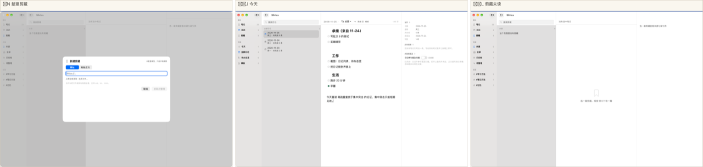

[原图](artifacts/09-shortcut-actions.png) · 通过 · 判据 ⌘N 按模块分流；⌘⇧J 定位今天；⌘⇧L 定位剪藏未读

状态矩阵 ⌘N 新建剪藏 / ⌘⇧J 今天 / ⌘⇧L 剪藏未读

### 10 快捷键：⌘⇧T / ⌘,

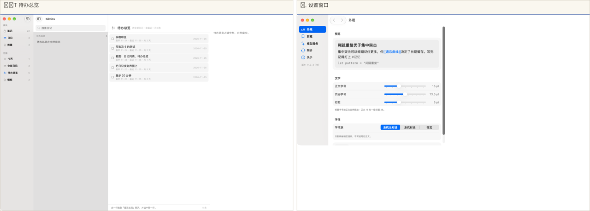

[原图](artifacts/10-shortcut-todos-settings.png) · 通过 · 判据 ⌘⇧T 切到中栏待办总览；⌘, 打开独立设置窗口

状态矩阵 ⌘⇧T 待办总览 / ⌘, 设置窗口

### 11 三模块空态

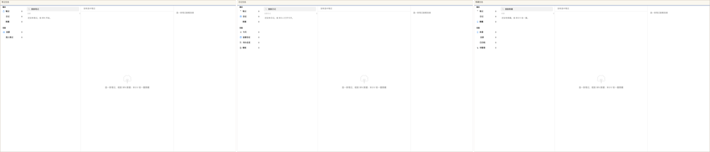

[原图](artifacts/11-empty-states.png) · 通过 · 判据 空态文案按模块给，不出现「没有选中笔记」

状态矩阵 笔记空态 / 日记空态 / 剪藏空态

### 12 搜索只搜当前模块

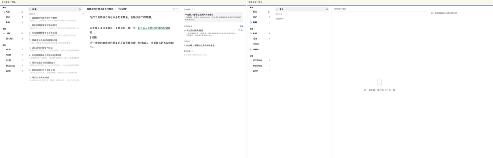

[原图](artifacts/12-search-scope.png) · 通过 · 判据 同一搜索词只在本模块出结果，「只搜笔记 / 含日记」开关已删

状态矩阵 笔记里搜「链接」 / 剪藏里搜「笔记」

### 13 日记右栏：当天统计

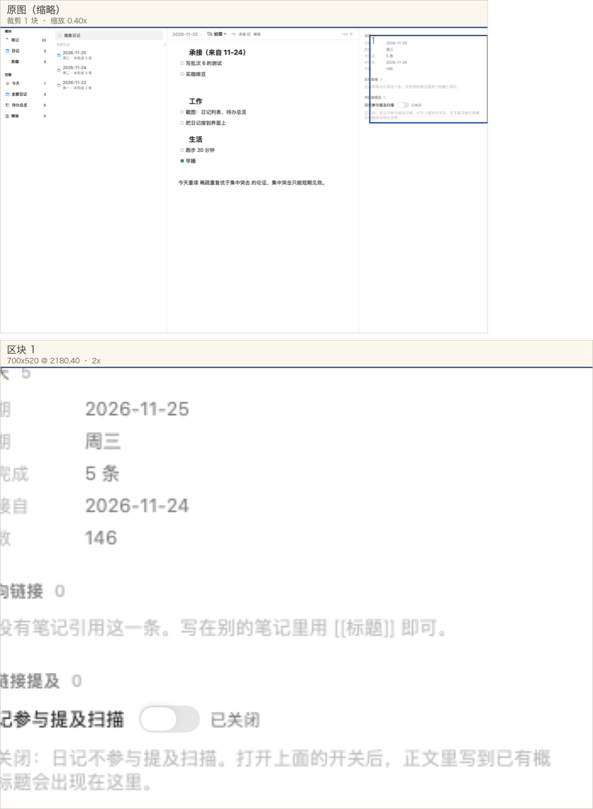

[原图](artifacts/13-journal-context-2x.png) · 通过 · 判据 右栏给出日期、星期、未完成条数、承接自、字数，并保留反向链接与提及开关

细节放大 1 块 x2

### 14 列表栏宽度可拖且记忆

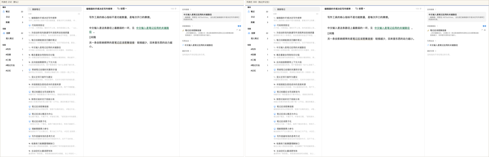

[原图](artifacts/14-list-width.png) · 通过 · 判据 拖到 300 后宽度落盘，重开还原；越界钳在 200–360

SILVICS_LIST_WIDTH=300 复现

## 截图清单

| 文件 | 说明 | 差异 |
| --- | --- | --- |
| `artifacts/01-before-after.png` | 同一演示 vault | — |
| `artifacts/02-list-collapse.png` | 状态矩阵 列表栏展开 / 列表栏收起 | — |
| `artifacts/03-narrow.png` | 900x820 | — |
| `artifacts/04-modules.png` | 状态矩阵 笔记 / 日记 / 剪藏 | — |
| `artifacts/05-clip-scopes.png` | 状态矩阵 未读 / 待整理 / 标签命中 | — |
| `artifacts/06-tags.png` | 状态矩阵 笔记标签 #笔记方法 / 剪藏标签 #学习方法 | — |
| `artifacts/07-todos-templates.png` | 状态矩阵 待办总览（中栏） / 日记模板（中栏） | — |
| `artifacts/08-shortcut-module.png` | 状态矩阵 ⌘1 笔记 / ⌘2 日记 / ⌘3 剪藏 | — |
| `artifacts/09-shortcut-actions.png` | 状态矩阵 ⌘N 新建剪藏 / ⌘⇧J 今天 / ⌘⇧L 剪藏未读 | — |
| `artifacts/10-shortcut-todos-settings.png` | 状态矩阵 ⌘⇧T 待办总览 / ⌘, 设置窗口 | — |
| `artifacts/11-empty-states.png` | 状态矩阵 笔记空态 / 日记空态 / 剪藏空态 | — |
| `artifacts/12-search-scope.png` | 状态矩阵 笔记里搜「链接」 / 剪藏里搜「笔记」 | — |
| `artifacts/13-journal-context-2x.png` | 细节放大 1 块 x2 | — |
| `artifacts/14-list-width.png` | SILVICS_LIST_WIDTH=300 复现 | — |
