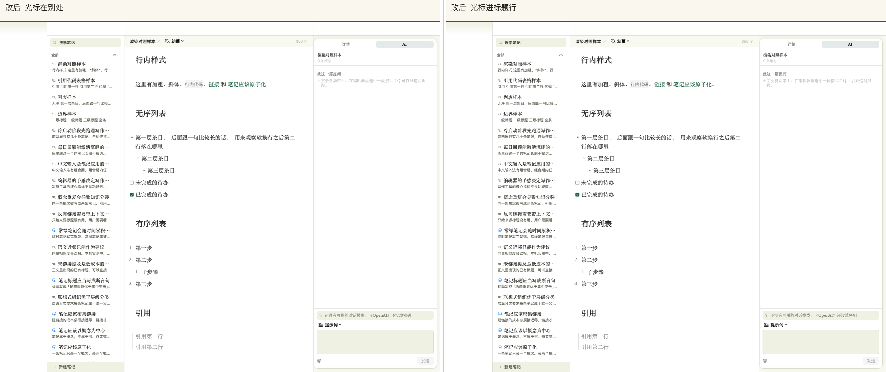
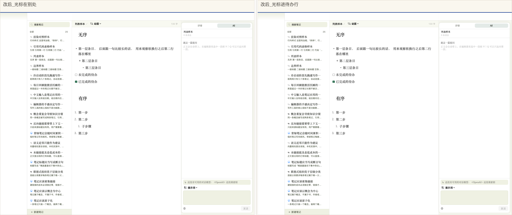
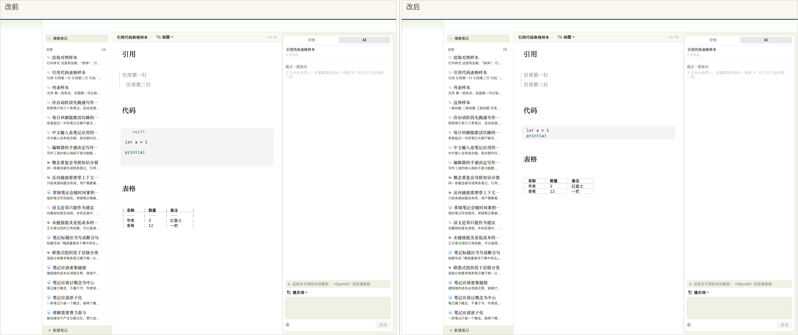
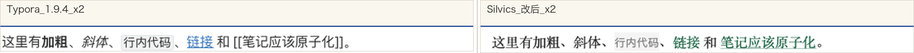
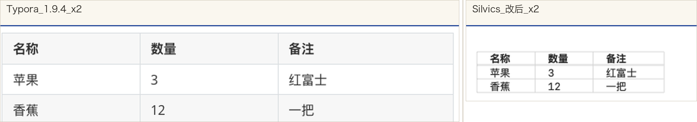
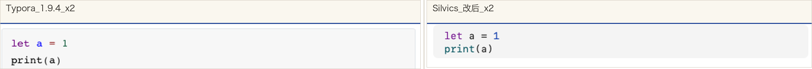
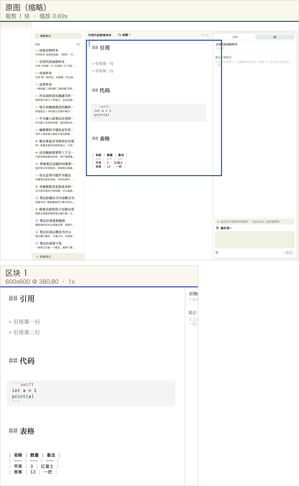
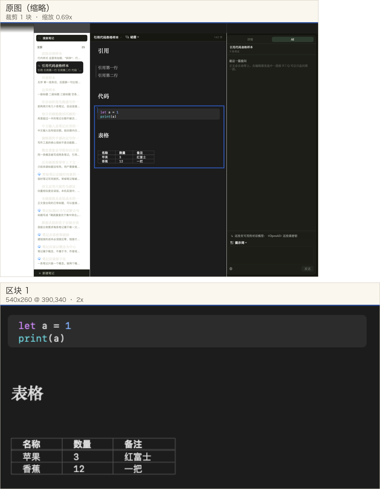

# silvics · typora-mode 验收报告

## 元信息

| 项 | 值 |
| --- | --- |
| commit | f7f633d |
| 验收时间 | 2026-11-27 23:16 CST |
| 环境 | macOS 26 (arm64)，Debug 构建，窗口 1320x1050 |
| 数据 | /tmp/ui-audit/vault 样本笔记 4 篇（行内样式 / 列表 / 引用代码表格 / 边界） |
| 缓存版本 | EditorStylePlan 冷启动（每次重启 App） |
| 验收人 | agent |

## 结论

通过 11 项，不通过 3 项，待确认 0 项，未覆盖 0 项。

## 覆盖用例

| # | 用例 | 判据 | 结果 | 证据 |
| --- | --- | --- | --- | --- |
| 01 | 01 行内标记不再留空洞 | 渲染态正文连续，标记不占宽 | 通过 | `artifacts/01-inline.png` |
| 02 | 02 改前：光标进标题行，整行右移 33px | 光标进出不应改变正文位置 | 不通过 | `artifacts/02-heading-before.png` |
| 03 | 02 改后：光标进标题行，画面零像素差异 | 光标进出不应改变正文位置 | 通过 | `artifacts/02-heading-after.png` |
| 04 | 03 改前：光标进列表行，首行 +10px、续行不动 | 同段首行与续行左缘一致 | 不通过 | `artifacts/03-list-before.png` |
| 05 | 03 改后：光标进列表行，画面零像素差异 | 同段首行与续行左缘一致 | 通过 | `artifacts/03-list-after.png` |
| 06 | 04 改前：光标进待办行，正文 +28px 且复选框消失 | 光标进出不应改变正文位置 | 不通过 | `artifacts/04-todo-before.png` |
| 07 | 04 改后：光标进待办行，方框仍在、正文不动 | 光标进出不应改变正文位置 | 通过 | `artifacts/04-todo-after.png` |
| 08 | 05 多行引用：第二行不再右移 13px | 同段各行左缘一致 | 通过 | `artifacts/05-quote.png` |
| 09 | 06 表格分隔行与代码块围栏不再露原文 | 分隔行 / 围栏行渲染态不可见 | 通过 | `artifacts/06-blocks.png` |
| 10 | 07 与 Typora 对照：行内样式那一行 | 标记零占位、链接只显文字 | 通过 | `artifacts/07-typora-inline.png` |
| 11 | 08 与 Typora 对照：表格 | 分隔行不显示、有网格线 | 通过 | `artifacts/08-typora-table.png` |
| 12 | 09 与 Typora 对照：代码块 | 无围栏、无语言名残留、行距紧凑 | 通过 | `artifacts/09-typora-code.png` |
| 13 | 10 源码模式 ⌘/：所有标记恢复原宽 | 块级标记有一个看得见、能直接改的出口 | 通过 | `artifacts/10-source.png` |
| 14 | 11 深色模式下的代码块与表格网格 | 网格线与代码底色在深色下可见 | 通过 | `artifacts/11-dark.png` |

## 偏差清单

| 区域 | 设计稿值 | 实现值 | 判定 | 证据 |
| --- | --- | --- | --- | --- |
| 行内标记 | 渲染态零占位 | 改前占 9–14px | 已修复 | `artifacts/01-inline.png` |
| 标题 / 列表 / 待办标记 | 永不露源码，光标进出不重排 | 改前 33 / 10 / 28px 横向位移 | 已修复 | `artifacts/03-list-after.png` |
| 多行引用 | 每行前缀都压宽 | 改前只压第一行，第 2 行起 +13px | 已修复 | `artifacts/05-quote.png` |
| 表格 | 分隔行不显示、有网格 | 改前显示 ---，只有淡 pipe | 已修复 | `artifacts/06-blocks.png` |
| 代码块 | 围栏整行隐藏、行距紧凑 | 改前残留 vue 语言名、行距 36px | 已修复 | `artifacts/06-blocks.png` |
| 源码编辑出口 | Typora 的 ⌘/ 源码模式 | 已补 ⌘/：所有标记恢复原宽、装饰不画 | 已修复 | `artifacts/10-source.png` |

## 未覆盖

无。

## 复现命令

```bash
SILVICS_VAULT=/tmp/ui-audit/vault SILVICS_DB=/tmp/ui-audit/db.sqlite SILVICS_SELECT=列表样本 SILVICS_CARET=第一层条目 SILVICS_CAPTURE=/tmp/ui-audit/raw/x.png ~/work/dev/Silvics-ui-audit/.build/Build/Products/Debug/Silvics.app/Contents/MacOS/Silvics
```

## 证据图

### 01 01 行内标记不再留空洞


[原图](artifacts/01-inline.png) · 通过 · 判据 渲染态正文连续，标记不占宽

改前 `**`、`*`、反引号各占 9–14px 却透明；改后压到 ≈0 宽，光标落进这一段才露出源码。

### 02 02 改前：光标进标题行，整行右移 33px


[原图](artifacts/02-heading-before.png) · 不通过 · 判据 光标进出不应改变正文位置

改前 `##` 在本行恢复原字号，标题 406→439。

### 03 02 改后：光标进标题行，画面零像素差异



[原图](artifacts/02-heading-after.png) · 通过 · 判据 光标进出不应改变正文位置

两次截图 md5 完全相同（7fa157d9…），说明光标进出没有触发任何重排。

### 04 03 改前：光标进列表行，首行 +10px、续行不动


[原图](artifacts/03-list-before.png) · 不通过 · 判据 同段首行与续行左缘一致

首行 407→417，软换行后的第二行仍在 407，段内错位 10px。

### 05 03 改后：光标进列表行，画面零像素差异


[原图](artifacts/03-list-after.png) · 通过 · 判据 同段首行与续行左缘一致

项目符号与正文都不动；两次截图 md5 相同。

### 06 04 改前：光标进待办行，正文 +28px 且复选框消失


[原图](artifacts/04-todo-before.png) · 不通过 · 判据 光标进出不应改变正文位置

正文 407→435；方框被撤掉换成 `- [ ]` 源码，可点区域闪没。

### 07 04 改后：光标进待办行，方框仍在、正文不动



[原图](artifacts/04-todo-after.png) · 通过 · 判据 光标进出不应改变正文位置

复选框与光标无关，一直显示；两次截图 md5 相同。

### 08 05 多行引用：第二行不再右移 13px


[原图](artifacts/05-quote.png) · 通过 · 判据 同段各行左缘一致

改前只压第一行前缀（正文 408 / 421）；改后逐行压宽，两行同缘（407 / 407）。

### 09 06 表格分隔行与代码块围栏不再露原文



[原图](artifacts/06-blocks.png) · 通过 · 判据 分隔行 / 围栏行渲染态不可见

改前表格第二行是 `| --- | --- |`，代码块左上角残留语言名且块顶空一行；改后分隔行透明压扁、围栏整行折殁、行距收紧。

### 10 07 与 Typora 对照：行内样式那一行



[原图](artifacts/07-typora-inline.png) · 通过 · 判据 标记零占位、链接只显文字

同内容文件。Typora 无空洞、链接蓝、wiki 原文；Silvics 无空洞、链接主题绿、wiki 额外渲染成引用。

### 11 08 与 Typora 对照：表格



[原图](artifacts/08-typora-table.png) · 通过 · 判据 分隔行不显示、有网格线

两边都没有 `---` 行；都有完整网格。差异：Typora 列宽等分并带单元格内边距，Silvics 列宽按内容、无内边距。

### 12 09 与 Typora 对照：代码块



[原图](artifacts/09-typora-code.png) · 通过 · 判据 无围栏、无语言名残留、行距紧凑

改后余留差异：Typora 块内上内边距 8px、Silvics 4px；字号 13pt 对 16px。

### 13 10 源码模式 ⌘/：所有标记恢复原宽



[原图](artifacts/10-source.png) · 通过 · 判据 块级标记有一个看得见、能直接改的出口

细节放大 1 块 x1

### 14 11 深色模式下的代码块与表格网格



[原图](artifacts/11-dark.png) · 通过 · 判据 网格线与代码底色在深色下可见

细节放大 1 块 x2

## 截图清单

| 文件 | 说明 | 差异 |
| --- | --- | --- |
| `artifacts/01-inline.png` | 改前 `**`、`*`、反引号各占 9–14px 却透明；改后压到 ≈0 宽，光标落进这一段才露出源码。 | — |
| `artifacts/02-heading-before.png` | 改前 `##` 在本行恢复原字号，标题 406→439。 | — |
| `artifacts/02-heading-after.png` | 两次截图 md5 完全相同（7fa157d9…），说明光标进出没有触发任何重排。 | — |
| `artifacts/03-list-before.png` | 首行 407→417，软换行后的第二行仍在 407，段内错位 10px。 | — |
| `artifacts/03-list-after.png` | 项目符号与正文都不动；两次截图 md5 相同。 | — |
| `artifacts/04-todo-before.png` | 正文 407→435；方框被撤掉换成 `- [ ]` 源码，可点区域闪没。 | — |
| `artifacts/04-todo-after.png` | 复选框与光标无关，一直显示；两次截图 md5 相同。 | — |
| `artifacts/05-quote.png` | 改前只压第一行前缀（正文 408 / 421）；改后逐行压宽，两行同缘（407 / 407）。 | — |
| `artifacts/06-blocks.png` | 改前表格第二行是 `| --- | --- |`，代码块左上角残留语言名且块顶空一行；改后分隔行透明压扁、围栏整行折殁、行距收紧。 | — |
| `artifacts/07-typora-inline.png` | 同内容文件。Typora 无空洞、链接蓝、wiki 原文；Silvics 无空洞、链接主题绿、wiki 额外渲染成引用。 | — |
| `artifacts/08-typora-table.png` | 两边都没有 `---` 行；都有完整网格。差异：Typora 列宽等分并带单元格内边距，Silvics 列宽按内容、无内边距。 | — |
| `artifacts/09-typora-code.png` | 改后余留差异：Typora 块内上内边距 8px、Silvics 4px；字号 13pt 对 16px。 | — |
| `artifacts/10-source.png` | 细节放大 1 块 x1 | — |
| `artifacts/11-dark.png` | 细节放大 1 块 x2 | — |
