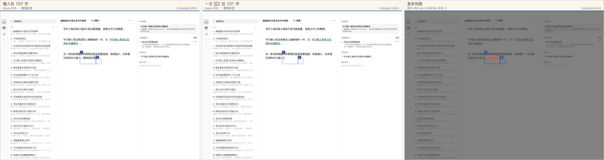
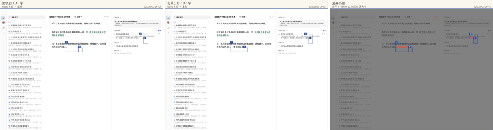
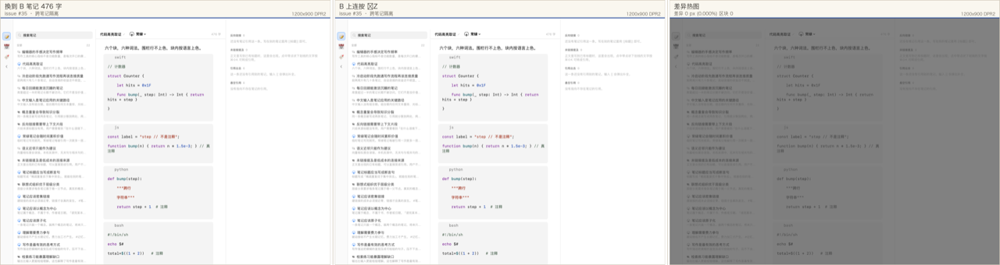
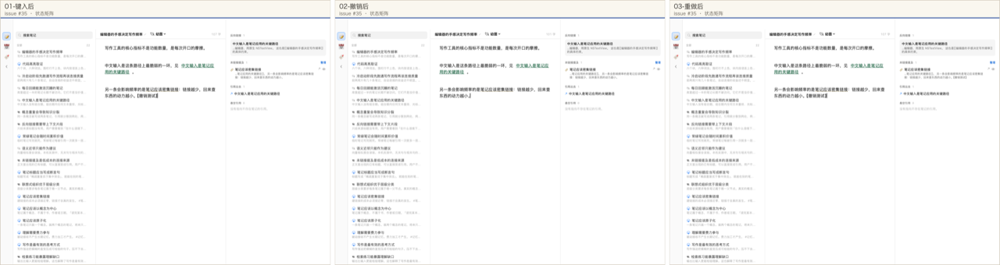

# silvics · release/0.6.4 验收报告

## 元信息

| 项 | 值 |
| --- | --- |
| commit | 34cc05c |
| 验收时间 | 2026-11-26 13:00 CST |
| 环境 | macOS 27 / Apple 芯片 / Debug 构建 / SILVICS_SEED=1 / 窗口 1200x900 |
| 数据 | App 自绘截图（cacheDisplay，无需录屏授权）；字数取编辑器右上角与右侧元数据 |
| 缓存版本 | 待确认 |
| 验收人 | agent |

## 结论

通过 4 项，不通过 0 项，待确认 0 项，未覆盖 3 项。

## 覆盖用例

| # | 用例 | 判据 | 结果 | 证据 |
| --- | --- | --- | --- | --- |
| 01 | U1 一次 ⌘Z 只退刚键入的这一段 | 正文 107→101 字，差异只落在正文最后一行，不是整篇清空 | 通过 | `artifacts/01-键入后-107-字-一次-Z-后-101-字.png` |
| 02 | U2 重做把被撤销的正文补回来 | 正文 101→107 字，与撤销前一致 | 通过 | `artifacts/02-撤销后-101-字-Z-后-107-字.png` |
| 03 | U3 换笔记后 ⌘Z 不改到别的笔记 | B 前后像素完全一致（差异 0 区块）；撤销栈按笔记隔离 | 通过 | `artifacts/03-换到-B-笔记-476-字-B-上连按-Z.png` |
| 04 | U4 状态矩阵：键入 / 撤销 / 重做 | 三格字数 107 → 101 → 107，可逐格读数 | 通过 | `artifacts/04-状态矩阵-01-键入后-02-撤销后-03-重做后.png` |

## 偏差清单

| 区域 | 设计稿值 | 实现值 | 判定 | 证据 |
| --- | --- | --- | --- | --- |
| 取证脚本（合成 ⌘⇧Z） | performKeyEquivalent 命中 Redo 菜单项 | 只有 characters 传大写 Z 才命中；真实键盘不受影响 | 设计稿未覆盖 | 缺 |

## 未覆盖

| 用例 | 原因 |
| --- | --- |
| 中文输入法组合态下撤销 | 需要真实输入法与真机交互；已按「组合期间不记录」实现，仅单测覆盖路径 |
| 大正文（100 KB）撤销性能 | 每步存全文快照，未跑大数据量计时；上限 200 步 |
| 菜单标题本地化 | Edit 菜单由 SwiftUI 提供，标题随系统语言；未逐语言截图 |

## 复现命令

```bash
cd ~/work/dev/Silvics-undo && export DEVELOPER_DIR=/Applications/Xcode.app/Contents/Developer && xcodegen generate && xcodebuild -project Silvics.xcodeproj -scheme Silvics -configuration Debug -destination "platform=macOS" -derivedDataPath .build CODE_SIGNING_ALLOWED=NO test
open .build/Build/Products/Debug/Silvics.app --env SILVICS_VAULT=/tmp/vault-r1 --env SILVICS_SEED=1 --env SILVICS_SELFTEST=undo-same --env SILVICS_UNDO_SHOTS=/tmp/reports/undo-raw/same --env SILVICS_WINDOW=1200x900 --env SILVICS_SELECT=编辑器的手感决定写作频率
open .build/Build/Products/Debug/Silvics.app --env SILVICS_VAULT=/tmp/vault-r2 --env SILVICS_SEED=1 --env SILVICS_SELFTEST=undo-switch --env SILVICS_UNDO_SHOTS=/tmp/reports/undo-raw/switch --env SILVICS_WINDOW=1200x900
```

## 证据图

### 01 U1 一次 ⌘Z 只退刚键入的这一段



[原图](artifacts/01-键入后-107-字-一次-Z-后-101-字.png) · 通过 · 差异 862 px (0.080%) 区块 2 · 判据 正文 107→101 字，差异只落在正文最后一行，不是整篇清空

键入后 107 字 / 一次 ⌘Z 后 101 字

### 02 U2 重做把被撤销的正文补回来



[原图](artifacts/02-撤销后-101-字-Z-后-107-字.png) · 通过 · 差异 1179 px (0.109%) 区块 4 · 判据 正文 101→107 字，与撤销前一致

撤销后 101 字 / ⌘⇧Z 后 107 字

### 03 U3 换笔记后 ⌘Z 不改到别的笔记



[原图](artifacts/03-换到-B-笔记-476-字-B-上连按-Z.png) · 通过 · 差异 0 px (0.000%) 区块 0 · 判据 B 前后像素完全一致（差异 0 区块）；撤销栈按笔记隔离

换到 B 笔记 476 字 / B 上连按 ⌘Z

### 04 U4 状态矩阵：键入 / 撤销 / 重做



[原图](artifacts/04-状态矩阵-01-键入后-02-撤销后-03-重做后.png) · 通过 · 判据 三格字数 107 → 101 → 107，可逐格读数

状态矩阵 01-键入后 / 02-撤销后 / 03-重做后

## 截图清单

| 文件 | 说明 | 差异 |
| --- | --- | --- |
| `artifacts/01-键入后-107-字-一次-Z-后-101-字.png` | 键入后 107 字 / 一次 ⌘Z 后 101 字 | 差异 862 px (0.080%) 区块 2 |
| `artifacts/02-撤销后-101-字-Z-后-107-字.png` | 撤销后 101 字 / ⌘⇧Z 后 107 字 | 差异 1179 px (0.109%) 区块 4 |
| `artifacts/03-换到-B-笔记-476-字-B-上连按-Z.png` | 换到 B 笔记 476 字 / B 上连按 ⌘Z | 差异 0 px (0.000%) 区块 0 |
| `artifacts/04-状态矩阵-01-键入后-02-撤销后-03-重做后.png` | 状态矩阵 01-键入后 / 02-撤销后 / 03-重做后 | — |
