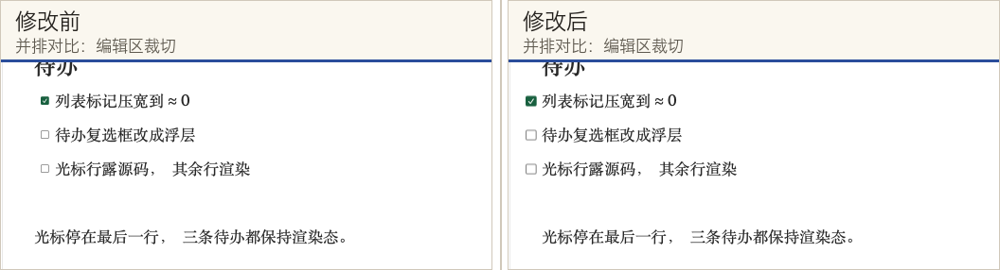
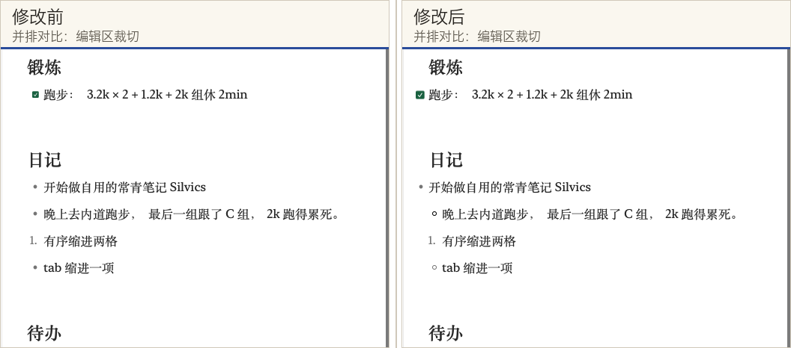
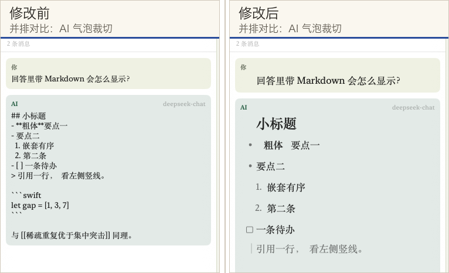
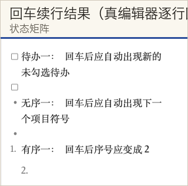
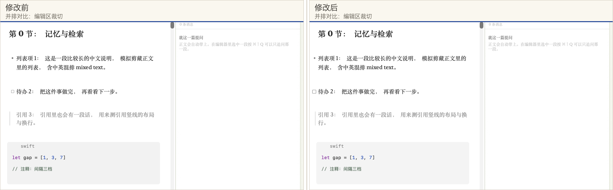

# silvics · issue50 验收报告

## 元信息

| 项 | 值 |
| --- | --- |
| commit | d0568d5 |
| 验收时间 | 2026-11-27 18:26 CST |
| 环境 | macOS 27 / Apple 芯片 / Debug 构建 / TextKit 2 |
| 数据 | vault=/tmp/issue50/*；演示数据由 SILVICS_SHOW 播种；对照构建取 main（v0.8.1） |
| 缓存版本 | .build（Debug） |
| 验收人 | pi agent |

## 结论

通过 6 项，不通过 0 项，待确认 0 项，未覆盖 3 项。

## 覆盖用例

| # | 用例 | 判据 | 结果 | 证据 |
| --- | --- | --- | --- | --- |
| 01 | 待办：正文左缘与复选框尺寸 | 待办正文与标题、正文同一左缘；复选框 14 → 17，挂在正文左侧不压字 | 通过 | `artifacts/01-todo-align.png` |
| 02 | 多级缩进与层级符号 | 2 空格或 1 个 tab 算一级；第 2 级右移 18pt 换空心圆；引用同样按层级排 | 通过 | `artifacts/02-nest.png` |
| 03 | AI 会话：复用编辑器渲染 | 标题、粗体、列表、嵌套有序、待办复选框、引用竖线、代码块、[[ ]] 按编辑器同一套规则渲染 | 通过 | `artifacts/03-ai-markdown.png` |
| 04 | 回车续行：待办 / 无序 / 有序 | 待办回车出新未勾选待办；无序出新符号；有序序号 +1；光标落在新项 | 通过 | `artifacts/04-enter.png` |
| 05 | 长文剪藏：打开后的渲染等价 | 6.5 万字剪藏打开后标题/列表/待办/引用/代码块/表格排版与修改前一致；单次样式重排 34k 字样本 232 → 181ms，命中缓存 53ms（Debug） | 通过 | `artifacts/05-longclip.png` |
| 06 | 待办复选框 4 倍细节 | 方框从 14 放大到 17，与 16.5pt 正文视觉重量相称；左缘仍留 2pt 间隔不压字 | 通过 | `artifacts/06-checkbox-4x.png` |

## 偏差清单

| 区域 | 设计稿值 | 实现值 | 判定 | 证据 |
| --- | --- | --- | --- | --- |
| 编辑器左缘（列表/待办/引用） | 正文与标题同左缘 | 原为固定 22pt 缩进 | 已修复 | `artifacts/01-todo-align.png` |
| 多级列表 / 引用 | 2 空格或 1 tab 一级，每级 18pt | 原实现缩进只记录不参与布局；现按层级排版并换符号 • / ◦ / ▪ | 已修复 | `artifacts/02-nest.png` |
| AI 气泡排版 | 与编辑器同一套渲染 | 原为纯文本贴 Markdown；现复用只读编辑器（紧凑 + 高度自适应） | 已修复 | `artifacts/03-ai-markdown.png` |
| 待办复选框尺寸 | 未标注（issue 只说「大一点」） | 14 → 17，挂进正文左缘左侧的 gutter | 设计稿未覆盖 | `artifacts/06-checkbox-4x.png` |

## 未覆盖

| 用例 | 原因 |
| --- | --- |
| 中文输入法组合态下按回车 | 自动化无法驱动真实 IME 组合；续行在 hasMarkedText 时直接让路，EditorIMETests / EditorComposeRenderTests 守着 |
| 跨多行选区按回车 | 本轮只处理无选区回车；有选区仍走 AppKit 默认（删除后换行），未改行为 |
| Release 构建下的用户可感知延迟 | Release 不带 DEBUG 取证钩子，无法在 Release 上打 [style] 行；数字见「复现命令」末条 |

## 复现命令

```bash
export DEVELOPER_DIR=/Applications/Xcode.app/Contents/Developer && cd ~/work/dev/Silvics-issue50 && xcodegen generate && xcodebuild -project Silvics.xcodeproj -scheme Silvics -configuration Debug -destination "platform=macOS" -derivedDataPath .build CODE_SIGNING_ALLOWED=NO test
SILVICS_DB=/tmp/s50-db.sqlite SILVICS_VAULT=/tmp/s50-v SILVICS_SHOW=lists SILVICS_SELECT=待办 SILVICS_WINDOW=1280x880 .build/Build/Products/Debug/Silvics.app/Contents/MacOS/Silvics
SILVICS_SELFTEST=enter-continue SILVICS_DB=/tmp/s50-enter.sqlite SILVICS_VAULT=/tmp/s50-enter SILVICS_WINDOW=1000x700 .build/Build/Products/Debug/Silvics.app/Contents/MacOS/Silvics
SILVICS_CLIP_LONG=1400 SILVICS_SHOW=clips-all SILVICS_STYLE_TRACE=1 SILVICS_DB=/tmp/s50-long.sqlite SILVICS_VAULT=/tmp/s50-long .build/Build/Products/Debug/Silvics.app/Contents/MacOS/Silvics  # 输出 [style] chars=… cache=… total=… ms
性能数据（本分支实测）：34k 字同一样本 Debug —— 改前 232ms；改后冷启动 181ms、命中缓存 53ms。65k 字剪藏 Release(-O) 冷启动 200ms、命中缓存 71ms。同一文档逐项：解析 64ms、单次行扫描 8ms（改前 5 次扫描共 41ms）、表格 9ms（改前 27ms）。
```

## 证据图

### 01 待办：正文左缘与复选框尺寸



[原图](artifacts/01-todo-align.png) · 通过 · 判据 待办正文与标题、正文同一左缘；复选框 14 → 17，挂在正文左侧不压字

同窗口同 vault，只截编辑区（520×220）；左为 main 构建，右为本分支

### 02 多级缩进与层级符号



[原图](artifacts/02-nest.png) · 通过 · 判据 2 空格或 1 个 tab 算一级；第 2 级右移 18pt 换空心圆；引用同样按层级排

SILVICS_SHOW=indent 演示笔记；左为 main（缩进不参与层级），右为本分支

### 03 AI 会话：复用编辑器渲染



[原图](artifacts/03-ai-markdown.png) · 通过 · 判据 标题、粗体、列表、嵌套有序、待办复选框、引用竖线、代码块、[[ ]] 按编辑器同一套规则渲染

同一份 ai/<note>.jsonl 喂给两个构建；右栏宽度与字号相同

### 04 回车续行：待办 / 无序 / 有序



[原图](artifacts/04-enter.png) · 通过 · 判据 待办回车出新未勾选待办；无序出新符号；有序序号 +1；光标落在新项

SILVICS_SELFTEST=enter-continue；日志：待办 ⏎ - [ ] ⏎ 无序 ⏎ - ⏎ 有序 ⏎ 2.

### 05 长文剪藏：打开后的渲染等价



[原图](artifacts/05-longclip.png) · 通过 · 判据 6.5 万字剪藏打开后标题/列表/待办/引用/代码块/表格排版与修改前一致；单次样式重排 34k 字样本 232 → 181ms，命中缓存 53ms（Debug）

同一篇 65,088 字剪藏、同一 vault；左为 main 构建，右为本分支

### 06 待办复选框 4 倍细节


[原图](artifacts/06-checkbox-4x.png) · 通过 · 判据 方框从 14 放大到 17，与 16.5pt 正文视觉重量相称；左缘仍留 2pt 间隔不压字

同一位置 4x 放大（150×40 裁切后放大）

## 截图清单

| 文件 | 说明 | 差异 |
| --- | --- | --- |
| `artifacts/01-todo-align.png` | 同窗口同 vault，只截编辑区（520×220）；左为 main 构建，右为本分支 | — |
| `artifacts/02-nest.png` | SILVICS_SHOW=indent 演示笔记；左为 main（缩进不参与层级），右为本分支 | — |
| `artifacts/03-ai-markdown.png` | 同一份 ai/<note>.jsonl 喂给两个构建；右栏宽度与字号相同 | — |
| `artifacts/04-enter.png` | SILVICS_SELFTEST=enter-continue；日志：待办 ⏎ - [ ] ⏎ 无序 ⏎ - ⏎ 有序 ⏎ 2. | — |
| `artifacts/05-longclip.png` | 同一篇 65,088 字剪藏、同一 vault；左为 main 构建，右为本分支 | — |
| `artifacts/06-checkbox-4x.png` | 同一位置 4x 放大（150×40 裁切后放大） | — |
